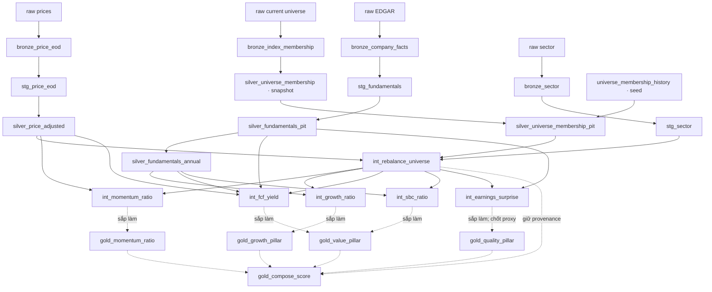

# Data Dictionary & Lộ trình — Raw → dbt → Gold

Cập nhật **15/10/2026**. Tài liệu mở rộng file Bronze & Staging cũ, đối chiếu SQL/Python trong workspace và schema bản sao warehouse đã build ngày 14/10. Mô tả code sau sửa semantics; warehouse đang dùng có thể còn schema cũ nếu chưa rebuild.

**Đã có code:** raw ingestion, 4 Bronze tables, 3 Staging views, 4 Silver models + 1 Silver snapshot, 6 Intermediate tables, 1 history seed. **Sắp làm:** 5 Gold models; cả 5 file SQL hiện vẫn rỗng. Mọi schema/công thức Gold trong tài liệu là đề xuất, chưa phải output đã build.

## Cách đọc

- **Grain:** một dòng đại diện cho điều gì. **Key:** tổ hợp nhận diện dòng theo thiết kế; không phải mọi key đã có uniqueness test.
- **Table:** dữ liệu vật lý trong DuckDB. **View:** query trên upstream, không persist thêm toàn bộ data. **Snapshot:** lưu các phiên bản thay đổi, chạy bằng dbt snapshot. **Seed:** CSV nạp bằng dbt seed.
- **As-of:** ở ngày rebalance chỉ dùng facts đã available và membership có window phù hợp.
- `DOUBLE` là số thực; `BIGINT`/`INTEGER` là số nguyên; `VARCHAR` là chuỗi; `DATE` là ngày; `TIMESTAMP` có thời gian.
- NULL là thiếu/không đủ dữ liệu; 0 là một giá trị thật. Ratio lưu decimal: 0.20 nghĩa là 20%.

**Mục lục**

1. [Luồng tổng thể](#1-luồng-tổng-thể)
2. [Raw và seed](#2-raw-và-seed)
3. [Bronze](#3-bronze)
4. [Staging](#4-staging)
5. [Silver](#5-silver)
6. [Intermediate](#6-intermediate)
7. [Gold sắp làm](#7-gold-sắp-làm--schema-đề-xuất)
8. [Thứ tự chạy](#8-chạy-step-by-step)
9. [Checklist Gold](#9-checklist-triển-khai-gold)
10. [Ví dụ một dòng dữ liệu](#10-ví-dụ-một-dòng-đi-đến-gold)

## 1. Luồng tổng thể



| Stage | Làm gì? | Kết quả để đi tiếp |
| --- | --- | --- |
| Raw | Fetch, parse, validate, lưu file | Giá/facts/current universe/sector; history ở nhánh seed riêng |
| Bronze | Đọc file, ép kiểu, clean một số chuỗi | Source data đã typed trong DuckDB |
| Staging | Rename snake_case, chuẩn hóa unit/form, lọc dòng | Giá/facts/sector dễ truy vấn |
| Silver | Dedup, availability/duration, giá và membership windows | Dữ liệu dùng được cho join theo thời gian |
| Intermediate | Grid tháng × ticker, facts as-of, ratios và z-scores | Bảng điểm của từng factor |
| Gold — dự kiến | Gộp factor → 4 pillar → composite | Monthly scoring cho backtest/screener |

Bronze giữ grain của file đã được ingestion parse, không phải toàn bộ JSON API gốc. Universe history đi qua seed, không qua Bronze/Staging.

## 2. Raw và seed

### 2.1 File đầu vào và đường đi

| File / pattern | Code tạo | Grain | Đi vào dbt qua |
| --- | --- | --- | --- |
| `data/raw/prices/price_<TICKER>.parquet` | ingestion/adapters/yahoo.py | Ticker × trade date | source('raw', 'prices') |
| `data/raw/edgar/edgar_<CIK>.parquet` | ingestion/adapters/edgar.py | Một reported fact; cùng kỳ có thể xuất hiện ở nhiều filing | source('raw', 'edgar') |
| data/raw/universe/universe.parquet | ingestion/universe.py | Ticker current sau mapping SEC | source('raw', 'universe') |
| data/raw/sector/sector.parquet | ingestion/adapters/sector.py | Ticker × sector/industry hiện tại | source('raw', 'sector') |
| dbt/seeds/universe_membership_history.csv | ingestion/universe_history.py hoặc CSV import có nguồn | Ticker × membership window | ref('universe_membership_history') |

`python -m ingestion.main` chạy ở root: tải current universe, hợp thêm tickers history vào danh sách fetch, tải giá/EDGAR tuần tự, rồi sector. CIK chưa map được vẫn thử tải giá; EDGAR bỏ qua và log warning. Giá mặc định lấy từ 2010-01-01, nhưng độ sâu thực tế tùy ticker/IPO/nguồn.

### 2.2 Schema raw

| Dataset | Các cột trong file | Kiểu Parquet đã đối chiếu mẫu |
| --- | --- | --- |
| Prices | Date; Open, High, Low, Close, Adj Close; Volume; Dividends, Stock Splits; Ticker | Date; 5 Float64; Int64; 2 Float64; String |
| EDGAR | cik, tag, value, unit, form, fy, fp, period_start, period_end, filing_date | String, String, Float64, String, String, Int64, String, Date, Date, Date |
| Current universe | Company, Ticker, CIK | 3 String |
| Sector | ticker, sector, industry | 3 String; industry có thể NULL |

Ý nghĩa từng cột được giải thích đầy đủ ở Bronze bên dưới. Tên raw giữ nguyên sang Bronze, trừ sector đổi sang PascalCase. Dtype raw khác dtype DuckDB sau cast, ví dụ fy Int64 → INTEGER.

EDGAR giữ 11 tags nền: Assets, Liabilities, NetIncomeLoss, Revenues, EarningsPerShareBasic, CommonStockSharesOutstanding, NetCashProvidedByUsedInOperatingActivities, PaymentsToAcquirePropertyPlantAndEquipment, ShareBasedCompensation, RevenueFromContractWithCustomerExcludingAssessedTax, SalesRevenueNet. Adapter bổ sung dei:EntityCommonStockSharesOutstanding, cho phép 20-F/40-F và giữ thêm bốn concepts để chẩn đoán (productive assets, tax-inclusive revenue, continuing-operations OCF, allocated SBC). Các concepts chẩn đoán không được alias ngầm; IFRS/currency conversion vẫn ngoài scope.

Giá/facts ghi atomic theo ticker/CIK; giá từ chối làm rơi ngày lịch sử đã có. Sector merge giữ ticker lịch sử rồi atomic replace. Metadata `data/raw/.watermarks/<TICKER>.json` có `last_updated` dạng chuỗi ngày, chỉ đánh dấu khi cả giá và EDGAR thành công; đây không phải bảng phân tích.

### 2.3 `universe_membership_history` — seed table

**Input:** CSV history. **Grain/key:** `(ticker, valid_from)`, window `[valid_from, valid_to)`. **Làm gì:** dbt seed nạp CSV thành table. **Output:** membership windows và provenance cho Silver.

| Cột đầu ra | Kiểu DuckDB | Ý nghĩa / nguồn |
| --- | --- | --- |
| `ticker` | `VARCHAR` | Ticker giao dịch; issuer được nhận diện qua CIK. |
| `cik` | `VARCHAR` | CIK của SEC, lưu dạng chuỗi; có thể NULL khi mapping lịch sử chưa có. |
| `company` | `VARCHAR` | Tên công ty. |
| `valid_from` | `DATE` | Ngày bắt đầu window, inclusive. |
| `valid_to` | `DATE` | Ngày kết thúc, exclusive; CSV import yêu cầu có giá trị. |
| `membership_quality` | `VARCHAR` | Seed nhận effective (ngày hiệu lực có nguồn xác minh) hoặc monthly_observation (archive). |
| `identifier_quality` | `VARCHAR` | Nguồn/chất lượng mapping CIK; seed dùng current_mapping/sec_filing_crosscheck; unmapped biểu diễn CIK chưa giải quyết. Registry nguồn ở config/historical_identifiers.csv. |
| `source_url` | `VARCHAR` | URL provenance; archive gắn với commit nguồn. |

Seed hiện có archive từ 31/07/2023. Downloader dùng phiên bản commit đầu tiên, ngày công bố + 1 ngày, carry-forward tối đa 40 ngày. Tên thư mục tháng không tự thành ngày hiệu lực. Seed không tự bổ sung giá/CIK/sector của ticker lịch sử. **Checkpoint Raw:** kiểm tra files, schema, freshness và fetch failures; file tồn tại chưa bảo đảm dữ liệu đủ.

## 3. Bronze

Cả 4 models đều `table`. `safe_cast = TRY_CAST` nên cast lỗi thành NULL; `clean_string = TRIM(UPPER(...))`. Bronze giữ số dòng/grain từ file parsed nhưng có thể đổi kiểu hoặc giá trị chuỗi.

### 3.1 `bronze_price_eod`

**Input:** raw.prices. **Grain/key kỳ vọng:** `(Ticker, Date)`. **Làm gì:** đọc glob Parquet, cast giá DOUBLE/volume BIGINT, clean ticker. **Output:** giá EOD typed cho Staging.

| Cột đầu ra | Kiểu DuckDB | Ý nghĩa / nguồn |
| --- | --- | --- |
| `Date` | `DATE` | Ngày giao dịch. |
| `Open` | `DOUBLE` | Giá mở cửa nguồn Yahoo. |
| `High` | `DOUBLE` | Giá cao nhất ngày. |
| `Low` | `DOUBLE` | Giá thấp nhất ngày. |
| `Close` | `DOUBLE` | Yahoo Close đã split-adjusted theo cơ sở nguồn; chưa dividend-adjusted dù auto_adjust=False. |
| `Adj Close` | `DOUBLE` | Giá Yahoo điều chỉnh split/cổ tức, dùng đối chiếu Silver. |
| `Volume` | `BIGINT` | Khối lượng giao dịch. |
| `Dividends` | `DOUBLE` | Cổ tức sự kiện ngày này; 0 khi không có. |
| `Stock Splits` | `DOUBLE` | Ratio split sự kiện; 2 nghĩa là 2-for-1, 0 là không có. Dùng khôi phục nominal price và điều chỉnh shares ở bước sau. |
| `Ticker` | `VARCHAR` | Ticker đã upper/trim. |

### 3.2 `bronze_company_facts`

**Input:** raw.edgar. **Grain:** reported fact, chưa unique theo kỳ vì nhiều filings nhắc lại facts. **Làm gì:** cast columns, clean CIK. **Output:** source facts typed, giữ tags/units/dates cho Staging.

| Cột đầu ra | Kiểu DuckDB | Ý nghĩa / nguồn |
| --- | --- | --- |
| `cik` | `VARCHAR` | CIK của SEC, lưu dạng chuỗi; có thể NULL khi mapping lịch sử chưa có. |
| `tag` | `VARCHAR` | XBRL tag giữ case nguồn. |
| `value` | `DOUBLE` | Giá trị chỉ tiêu, chưa tính ratio. |
| `unit` | `VARCHAR` | Đơn vị nguồn: USD, shares, USD/shares… |
| `form` | `VARCHAR` | Loại filing; ingestion cho phép 10-K/10-Q/20-F/40-F, giữ taxonomy và unit. |
| `fy` | `INTEGER` | Năm tài chính của filing. |
| `fp` | `VARCHAR` | Kỳ của filing; FY không chứng minh fact là annual. |
| `period_start` | `DATE` | Ngày đầu kỳ thực tế; NULL với instant fact. |
| `period_end` | `DATE` | Ngày cuối kỳ hoặc ngày đo instant fact. |
| `filing_date` | `DATE` | Ngày nộp báo cáo lên SEC, giữ để audit. |

### 3.3 `bronze_index_membership`

**Input:** raw.universe. **Grain/key:** ticker current. **Làm gì:** clean ba chuỗi. **Output:** input live snapshot; chưa có historical windows.

| Cột đầu ra | Kiểu DuckDB | Ý nghĩa / nguồn |
| --- | --- | --- |
| `Company` | `VARCHAR` | Tên công ty upper/trim. |
| `Ticker` | `VARCHAR` | Ticker current. |
| `CIK` | `VARCHAR` | CIK current của issuer. |

### 3.4 `bronze_sector`

**Input:** raw.sector. **Grain/key:** ticker. **Làm gì:** upper/trim, đổi ba tên raw sang PascalCase. **Output:** mapping ngành cho Staging.

| Cột đầu ra | Kiểu DuckDB | Ý nghĩa / nguồn |
| --- | --- | --- |
| `Ticker` | `VARCHAR` | Từ raw.ticker. |
| `Sector` | `VARCHAR` | Sector hiện tại Yahoo, không phải sector history hoặc GICS chính thức. |
| `Industry` | `VARCHAR` | Industry hiện tại, có thể NULL. |

**Checkpoint Bronze:** keys/dates có dữ liệu; cast không mất identifiers. Số ticker có thể khác số công ty do share classes.

## 4. Staging

Cả 3 models đều `view`: query trên Bronze, chưa persist một bộ data riêng và chưa tạo factors.

### 4.1 `stg_price_eod`

**Input:** bronze_price_eod. **Grain/key:** `(ticker, trade_date)`. **Làm gì:** rename; chỉ giữ Close không NULL và Volume >= 0 (Volume NULL cũng không qua). **Output:** input giá cho Silver.

| Cột đầu ra | Kiểu DuckDB | Ý nghĩa / nguồn |
| --- | --- | --- |
| `trade_date` | `DATE` | Từ Date. |
| `ticker` | `VARCHAR` | Từ Ticker. |
| `open_price` | `DOUBLE` | Từ Open. |
| `high_price` | `DOUBLE` | Từ High. |
| `low_price` | `DOUBLE` | Từ Low. |
| `close_price` | `DOUBLE` | Từ Close; vẫn là Yahoo split-adjusted Close. |
| `adj_close_price` | `DOUBLE` | Từ Adj Close, dùng validate. |
| `volume` | `BIGINT` | Từ Volume. |
| `dividend_amount` | `DOUBLE` | Từ Dividends. |
| `split_ratio` | `DOUBLE` | Từ Stock Splits; sự kiện được giữ cho xử lý sau. |

### 4.2 `stg_fundamentals`

**Input:** bronze_company_facts. **Grain:** reported fact, còn có thể trùng kỳ. **Làm gì:** rename, form filter 10-K/10-Q/20-F/40-F, tag chỉ trim, unit/form upper. **Output:** input dedup ở Silver.

| Cột đầu ra | Kiểu DuckDB | Ý nghĩa / nguồn |
| --- | --- | --- |
| `cik` | `VARCHAR` | CIK của SEC, lưu dạng chuỗi; có thể NULL khi mapping lịch sử chưa có. |
| `metric_tag` | `VARCHAR` | XBRL tag giữ case, ví dụ NetIncomeLoss. |
| `metric_value` | `DOUBLE` | Giá trị của chỉ tiêu; ở Silver là bản first-reported. |
| `unit_of_measure` | `VARCHAR` | Đơn vị upper/trim: USD, SHARES, USD/SHARES… Không tự quy đổi currency. |
| `filing_type` | `VARCHAR` | Loại filing: 10-K/10-Q/20-F/40-F; form không tự chứng minh annual. |
| `fiscal_year` | `INTEGER` | Năm tài chính của filing; không thay thế ngày của fact. |
| `fiscal_period` | `VARCHAR` | Kỳ của filing; FY không chứng minh fact là số cả năm. |
| `period_start_date` | `DATE` | Ngày bắt đầu kỳ thực tế; NULL với instant fact. |
| `period_end_date` | `DATE` | Ngày cuối kỳ thực tế hoặc ngày đo instant fact. |
| `filing_date` | `DATE` | Ngày nộp báo cáo lên SEC, giữ để audit. |

### 4.3 `stg_sector`

**Input:** bronze_sector. **Grain/key:** ticker. **Làm gì:** rename, bỏ Ticker NULL hoặc Sector NULL. **Output:** sector cho grid/z-score.

| Cột đầu ra | Kiểu DuckDB | Ý nghĩa / nguồn |
| --- | --- | --- |
| `ticker` | `VARCHAR` | Ticker giao dịch; issuer được nhận diện qua CIK. |
| `sector` | `VARCHAR` | Sector hiện tại từ Yahoo, được upper/trim; có thể NULL với ticker lịch sử. |
| `industry` | `VARCHAR` | Từ Industry, có thể NULL. |

**Checkpoint Staging:** ticker–date của giá unique, ticker sector unique, tag case/unit đúng. Lọc sector NULL không tự bảo đảm tất cả ticker lịch sử đều có sector.

## 5. Silver

### 5.1 `silver_fundamentals_pit` — table

**Input:** stg_fundamentals. **Grain/dedup key:** `(cik, metric_tag, unit_of_measure, period_start_date, period_end_date)`, start có thể NULL. **Làm gì:** ROW_NUMBER lấy filing_date sớm nhất, ưu tiên 10-K nếu cùng ngày; giữ first-reported value. Thêm availability/duration. **Output:** facts cho chọn as-of ở từng rebalance.

| Cột đầu ra | Kiểu DuckDB | Ý nghĩa / nguồn |
| --- | --- | --- |
| `cik` | `VARCHAR` | CIK của SEC, lưu dạng chuỗi; có thể NULL khi mapping lịch sử chưa có. |
| `metric_tag` | `VARCHAR` | XBRL tag giữ case, ví dụ NetIncomeLoss. |
| `metric_value` | `DOUBLE` | Giá trị của chỉ tiêu; ở Silver là bản first-reported. |
| `unit_of_measure` | `VARCHAR` | Đơn vị upper/trim: USD, SHARES, USD/SHARES… Không tự quy đổi currency. |
| `filing_type` | `VARCHAR` | Loại filing: 10-K/10-Q/20-F/40-F; form không tự chứng minh annual. |
| `fiscal_year` | `INTEGER` | Năm tài chính của filing; không thay thế ngày của fact. |
| `fiscal_period` | `VARCHAR` | Kỳ của filing; FY không chứng minh fact là số cả năm. |
| `period_start_date` | `DATE` | Ngày bắt đầu kỳ thực tế; NULL với instant fact. |
| `period_end_date` | `DATE` | Ngày cuối kỳ thực tế hoặc ngày đo instant fact. |
| `filing_date` | `DATE` | Ngày nộp báo cáo lên SEC, giữ để audit. |
| `available_date` | `DATE` | Ngày được phép dùng: filing_date + 1 ngày lịch. |
| `period_duration_days` | `BIGINT` | DATE_DIFF(day, start, end), BIGINT; NULL với instant fact. |

available_date = filing_date + 1 ngày lịch vì schema chưa có acceptance timestamp. Bảng chứa facts ở nhiều availability dates; Intermediate còn phải lọc <= rebalance_date. First-reported khác latest-restated-as-of: bảng này không giữ tất cả vintages để cập nhật restatement về sau.

### 5.2 `silver_fundamentals_annual` — view

**Input:** silver_fundamentals_pit. **Grain/key:** giữ key PIT nhưng chỉ annual duration facts. **Làm gì:** unit USD, start không NULL, duration 330–400 ngày, end >= start. **Output:** annual flows cho Growth/SBC và OCF/Capex của FCF. **Đủ 12 cột giống PIT:**

| Cột đầu ra | Kiểu DuckDB | Ý nghĩa / nguồn |
| --- | --- | --- |
| `cik` | `VARCHAR` | CIK của SEC, lưu dạng chuỗi; có thể NULL khi mapping lịch sử chưa có. |
| `metric_tag` | `VARCHAR` | XBRL tag giữ case, ví dụ NetIncomeLoss. |
| `metric_value` | `DOUBLE` | Giá trị của chỉ tiêu; ở Silver là bản first-reported. |
| `unit_of_measure` | `VARCHAR` | Đơn vị upper/trim: USD, SHARES, USD/SHARES… Không tự quy đổi currency. |
| `filing_type` | `VARCHAR` | Loại filing: 10-K/10-Q/20-F/40-F; form không tự chứng minh annual. |
| `fiscal_year` | `INTEGER` | Năm tài chính của filing; không thay thế ngày của fact. |
| `fiscal_period` | `VARCHAR` | Kỳ của filing; FY không chứng minh fact là số cả năm. |
| `period_start_date` | `DATE` | Ngày bắt đầu kỳ thực tế; NULL với instant fact. |
| `period_end_date` | `DATE` | Ngày cuối kỳ thực tế hoặc ngày đo instant fact. |
| `filing_date` | `DATE` | Ngày nộp báo cáo lên SEC, giữ để audit. |
| `available_date` | `DATE` | Ngày được phép dùng: filing_date + 1 ngày lịch. |
| `period_duration_days` | `BIGINT` | DATE_DIFF(day, start, end), BIGINT; NULL với instant fact. |

Không xác định annual bằng fiscal_period = FY. Bao gồm 52/53-week years; loại quarterly/YTD/kỳ chuyển tiếp ngắn. Annual đã công bố chưa phải rolling TTM. Assets/Liabilities/Shares dạng instant không nằm trong view annual.

### 5.3 `silver_price_adjusted` — table

**Input:** stg_price_eod. **Grain/key:** `(ticker, trade_date)`. **Làm gì:** prev_close → dividend factor → tích lũy ngược; dùng future split events để khôi phục nominal close. **Output:** chuỗi return/momentum và chuỗi nominal valuation riêng.

| Cột đầu ra | Kiểu DuckDB | Ý nghĩa / nguồn |
| --- | --- | --- |
| `ticker` | `VARCHAR` | Ticker giao dịch; issuer được nhận diện qua CIK. |
| `trade_date` | `DATE` | Ngày giao dịch. |
| `raw_close_price` | `DOUBLE` | stg.close_price; dù tên raw vẫn là Yahoo split-adjusted Close, không phải nominal. |
| `split_ratio` | `DOUBLE` | Split event ngày này. |
| `nominal_close_price` | `DOUBLE` | raw_close_price × tích split ratios SAU ngày giá; giá danh nghĩa cho market cap. |
| `dividend_adjustment_factor` | `DOUBLE` | Tích dividend factors SAU ngày giá; frame rỗng dùng 1. |
| `adjusted_close_price` | `DOUBLE` | raw_close_price × dividend_adjustment_factor; dùng return/momentum. |
| `volume` | `BIGINT` | Khối lượng từ Staging. |

Dividend factor ngày d = 1 − dividend_d / close_(d−1) khi dividend > 0 và prev_close > dividend; trường hợp khác dùng 1. Tích dùng EXP(SUM(LN(factor))). Không áp split thêm lần nữa lên adjusted_close_price.

### 5.4 `silver_universe_membership` — snapshot SCD2

**Input:** bronze_index_membership. **Grain:** ticker × snapshot version. **Key version:** dbt_scd_id. **Làm gì:** unique_key Ticker, check strategy/check_cols all; invalidate hard deletes. **Output:** lịch sử quan sát từ lúc chạy snapshot; chạy bằng dbt snapshot, không dbt run.

| Cột đầu ra | Kiểu DuckDB | Ý nghĩa / nguồn |
| --- | --- | --- |
| `Company` | `VARCHAR` | Tên công ty phiên bản Bronze. |
| `Ticker` | `VARCHAR` | Ticker business key được snapshot. |
| `CIK` | `VARCHAR` | CIK của phiên bản. |
| `dbt_scd_id` | `VARCHAR` | ID phiên bản do dbt tạo. |
| `dbt_updated_at` | `TIMESTAMP` | Metadata thời điểm phiên bản cập nhật/capture; không phải ngày hiệu lực source. |
| `dbt_valid_from` | `TIMESTAMP` | Thời điểm phiên bản bắt đầu được dbt ghi nhận. |
| `dbt_valid_to` | `TIMESTAMP` | Thời điểm kết thúc phiên bản; NULL là version còn mở. |

Snapshot hôm nay không khôi phục membership từ 2010; nó ghi thay đổi được quan sát từ khi khởi chạy.

### 5.5 `silver_universe_membership_pit` — table

**Input:** history seed + live snapshot. **Grain/key:** `(ticker, valid_from)`. **Làm gì:** snake_case, cast windows, CIK rỗng → NULL, UNION history với live observations. Live bắt đầu từ mốc muộn hơn giữa capture date + 1 ngày và max(valid_to) của history; end snapshot cũng chuyển sang ngày kế tiếp. **Output:** windows có provenance và quality cho grid.

| Cột đầu ra | Kiểu DuckDB | Ý nghĩa / nguồn |
| --- | --- | --- |
| `ticker` | `VARCHAR` | Ticker giao dịch; issuer được nhận diện qua CIK. |
| `cik` | `VARCHAR` | CIK của SEC, lưu dạng chuỗi; có thể NULL khi mapping lịch sử chưa có. |
| `company` | `VARCHAR` | Tên công ty. |
| `valid_from` | `TIMESTAMP` | Bắt đầu window inclusive; seed DATE được cast sang TIMESTAMP. |
| `valid_to` | `TIMESTAMP` | Kết thúc exclusive; NULL được phép với live version còn mở. |
| `membership_quality` | `VARCHAR` | effective / monthly_observation / live_observation: chất lượng membership. |
| `identifier_quality` | `VARCHAR` | Nguồn/chất lượng mapping CIK; seed dùng current_mapping/sec_filing_crosscheck; unmapped biểu diễn CIK chưa giải quyết. Registry nguồn ở config/historical_identifiers.csv. |
| `source_url` | `VARCHAR` | URL provenance; archive gắn với commit nguồn. |

Tên PIT mô tả window join; độ chính xác phụ thuộc membership_quality. effective khác monthly/live observations. Strict mode mặc định chỉ nhận effective. **Checkpoint Silver:** dedup key đúng, annual đúng duration/unit, availability có lag, giá dương, windows không overlap. Test giá Yahoo chọn lệch > 0.5%; cấu hình hiện WARN khi có mismatch và ERROR khi mismatch > 500 dòng, không phải mỗi mismatch đều fail.

## 6. Intermediate

Cả 6 models đều `table`. Grain/key mục tiêu chung: **ticker × rebalance_date**. Các factors LEFT JOIN từ grid để giữ dòng dù input/ratio/score NULL.

### 6.1 `int_rebalance_universe` — lưới chung

**Input:** silver_price_adjusted + silver_universe_membership_pit + stg_sector. **Làm gì:** MAX(trade_date) mỗi tháng, chỉ tháng trước tháng hiện tại; join valid_from trước cuối ngày rebalance, valid_to sau rebalance hoặc NULL. Mặc định chỉ effective; allow_observed_universe=true nhận monthly/live observations. LEFT JOIN sector current. **Output:** ticker–kỳ cần tính factor, CIK và provenance.

| Cột đầu ra | Kiểu DuckDB | Ý nghĩa / nguồn |
| --- | --- | --- |
| `rebalance_date` | `DATE` | Ngày rebalance: ngày giá cuối cùng trong một tháng đã kết thúc. |
| `ticker` | `VARCHAR` | Ticker giao dịch; issuer được nhận diện qua CIK. |
| `cik` | `VARCHAR` | CIK của SEC, lưu dạng chuỗi; có thể NULL khi mapping lịch sử chưa có. |
| `membership_quality` | `VARCHAR` | effective / monthly_observation / live_observation: chất lượng membership. |
| `identifier_quality` | `VARCHAR` | Nguồn/chất lượng mapping CIK; seed dùng current_mapping/sec_filing_crosscheck; unmapped biểu diễn CIK chưa giải quyết. Registry nguồn ở config/historical_identifiers.csv. |
| `membership_valid_from` | `TIMESTAMP` | valid_from từ Silver, audit membership join. |
| `membership_valid_to` | `TIMESTAMP` | valid_to từ Silver; có thể NULL. |
| `sector` | `VARCHAR` | Sector hiện tại từ Yahoo, được upper/trim; có thể NULL với ticker lịch sử. |

Ngày max trong dữ liệu là ngày chọn rebalance, không tự chứng minh cả tháng đã tải đủ giá. Kỳ trước coverage không được gán current members; không có kỳ phù hợp thì quality gate fail rõ ràng.

### 6.2 `int_momentum_ratio`

**Input:** grid + silver_price_adjusted. **Làm gì:** month_close từ toàn bộ giá, join tháng t−1 và t−12 theo calendar offsets; sử dụng cả giá trước ngày ticker vào index. **Công thức:** P(t−1)/P(t−12) − 1. **Output:** momentum raw và score; thiếu một mốc giá thì NULL.

| Cột đầu ra | Kiểu DuckDB | Ý nghĩa / nguồn |
| --- | --- | --- |
| `rebalance_date` | `DATE` | Ngày rebalance: ngày giá cuối cùng trong một tháng đã kết thúc. |
| `ticker` | `VARCHAR` | Ticker giao dịch; issuer được nhận diện qua CIK. |
| `sector` | `VARCHAR` | Sector hiện tại từ Yahoo, được upper/trim; có thể NULL với ticker lịch sử. |
| `price_t_minus_1` | `DOUBLE` | Adjusted close của ngày giá cuối cùng tháng trước rebalance. |
| `price_t_minus_12` | `DOUBLE` | Adjusted close của ngày giá cuối cùng tháng cách rebalance 12 tháng. |
| `momentum_12_1_raw` | `DOUBLE` | Return 12–1 dạng decimal; denominator 0 → NULL. |
| `momentum_zscore` | `DOUBLE` | Z-score đã kẹp; cao hơn là momentum cao hơn. |

### 6.3 `int_growth_ratio`

**Input:** grid + silver_fundamentals_annual. **Làm gì:** chọn annual Revenue mới nhất đã available; fallback theo thứ tự Revenues → RevenueFromContractWithCustomerExcludingAssessedTax → SalesRevenueNet trong cùng end date. NI khớp Revenue start/end. Revenue năm trước có cả start/end cách năm hiện tại 330–400 ngày và đã available. **Công thức:** growth = (Rev_t−Rev_prev)/abs(Rev_prev); margin = NI_t/Rev_t; Rule of 40 proxy = growth + margin. **Output:** các ratios, dates audit và score.

| Cột đầu ra | Kiểu DuckDB | Ý nghĩa / nguồn |
| --- | --- | --- |
| `rebalance_date` | `DATE` | Ngày rebalance: ngày giá cuối cùng trong một tháng đã kết thúc. |
| `ticker` | `VARCHAR` | Ticker giao dịch; issuer được nhận diện qua CIK. |
| `sector` | `VARCHAR` | Sector hiện tại từ Yahoo, được upper/trim; có thể NULL với ticker lịch sử. |
| `period_start_curr` | `DATE` | Ngày đầu annual Revenue hiện tại. |
| `period_end_curr` | `DATE` | Ngày cuối annual Revenue hiện tại; NI khớp cùng kỳ. |
| `previous_period_end_date` | `DATE` | Ngày cuối annual Revenue năm trước. |
| `revenue_available_date` | `DATE` | Availability Revenue hiện tại. |
| `income_available_date` | `DATE` | Availability NI cùng kỳ. |
| `previous_revenue_available_date` | `DATE` | Availability Revenue năm trước; cũng <= rebalance. |
| `rev_growth_yoy` | `DOUBLE` | Revenue YoY growth dạng decimal. |
| `net_margin` | `DOUBLE` | Net Income / Revenue, decimal. |
| `rule_of_40_raw` | `DOUBLE` | Growth + margin; 0.20 + 0.15 = 0.35. |
| `growth_zscore` | `DOUBLE` | Growth score đã chuẩn hóa/kẹp. |

`rev_curr`, `rev_prev`, `net_income_curr` dùng trong CTE nhưng không có trong SELECT cuối/bảng output. Audit các số này cần đọc/chạy CTE hoặc thêm output columns trong một thay đổi code riêng. Thiếu Revenue năm trước → growth/combined score NULL.

### 6.4 `int_fcf_yield`

**Input:** grid + annual OCF/Capex + PIT instant shares + prices/splits. **Làm gì:** OCF annual mới nhất, Capex khớp start/end; shares instant SHARES > 0, measurement/availability không sau rebalance. Nhân shares với splits từ measurement đến rebalance, dùng nominal price tại đúng rebalance. **Output:** thành phần/audit dates, FCF, market cap, yield và score.

| Cột đầu ra | Kiểu DuckDB | Ý nghĩa / nguồn |
| --- | --- | --- |
| `rebalance_date` | `DATE` | Ngày rebalance: ngày giá cuối cùng trong một tháng đã kết thúc. |
| `ticker` | `VARCHAR` | Ticker giao dịch; issuer được nhận diện qua CIK. |
| `sector` | `VARCHAR` | Sector hiện tại từ Yahoo, được upper/trim; có thể NULL với ticker lịch sử. |
| `price` | `DOUBLE` | Nominal close tại đúng rebalance; không phải dividend-adjusted return price. |
| `ocf` | `DOUBLE` | Operating Cash Flow annual USD đã available. |
| `capex` | `DOUBLE` | Capex annual USD khớp start/end OCF; có thể NULL. |
| `period_start_date` | `DATE` | Ngày bắt đầu kỳ thực tế; NULL với instant fact. |
| `period_end_date` | `DATE` | Ngày cuối kỳ thực tế hoặc ngày đo instant fact. |
| `ocf_available_date` | `DATE` | Availability OCF. |
| `capex_available_date` | `DATE` | Availability Capex cùng kỳ. |
| `reported_shares_outstanding` | `DOUBLE` | Instant CommonStockSharesOutstanding hoặc dei:EntityCommonStockSharesOutstanding, unit SHARES, > 0. |
| `shares_measurement_date` | `DATE` | Ngày đo shares, từ period_end_date của instant fact. |
| `shares_available_date` | `DATE` | Availability shares fact. |
| `shares_source_tag` | `VARCHAR` | Concept gốc của instant shares, giữ namespace DEI. |
| `shares_split_factor` | `DOUBLE` | Tích splits sau shares_measurement_date đến rebalance; không có split dùng 1. |
| `issuer_ticker_count` | `BIGINT` | Số ticker cùng CIK trong grid kỳ đó; chỉ tính market cap khi = 1. |
| `free_cash_flow` | `DOUBLE` | OCF − abs(Capex); thiếu Capex → NULL, reported zero giữ 0. |
| `shares_outstanding` | `DOUBLE` | Reported shares × shares_split_factor, đồng bộ cơ sở split với nominal price. |
| `market_cap` | `DOUBLE` | Price × shares_outstanding; NULL khi nhiều classes/giá không hợp lệ/shares thiếu. |
| `fcf_yield_raw` | `DOUBLE` | Free cash flow / market cap, decimal; FCF âm có thể cho yield âm. |
| `fcf_yield_zscore` | `DOUBLE` | Z-score FCF Yield; cao hơn là yield cao hơn. |

Shares là proxy báo cáo đã biết; chưa tính issuance/buyback chưa công bố. Multi-class guard chỉ đếm các ticker cùng CIK trong universe kỳ đó, chưa có class-level shares đầy đủ. Giá return và giá valuation là hai cột khác nhau.

### 6.5 `int_sbc_ratio`

**Input:** grid + annual Revenue/SBC. **Làm gì:** Revenue fallback như Growth; SBC khớp start/end, đã available. **Công thức:** SBC/Revenue; score = −zscore(raw ratio). **Output:** dilution/burden proxy; SBC thấp cho score tốt hơn.

| Cột đầu ra | Kiểu DuckDB | Ý nghĩa / nguồn |
| --- | --- | --- |
| `rebalance_date` | `DATE` | Ngày rebalance: ngày giá cuối cùng trong một tháng đã kết thúc. |
| `ticker` | `VARCHAR` | Ticker giao dịch; issuer được nhận diện qua CIK. |
| `sector` | `VARCHAR` | Sector hiện tại từ Yahoo, được upper/trim; có thể NULL với ticker lịch sử. |
| `period_start_date` | `DATE` | Ngày bắt đầu kỳ thực tế; NULL với instant fact. |
| `period_end_date` | `DATE` | Ngày cuối kỳ thực tế hoặc ngày đo instant fact. |
| `revenue_available_date` | `DATE` | Availability Revenue. |
| `sbc_available_date` | `DATE` | Availability SBC cùng kỳ. |
| `sbc` | `DOUBLE` | ShareBasedCompensation annual USD. |
| `revenue` | `DOUBLE` | Revenue annual USD cùng kỳ. |
| `sbc_ratio_raw` | `DOUBLE` | SBC / Revenue, decimal. |
| `sbc_zscore` | `DOUBLE` | Z-score đã đảo dấu; SBC thấp có điểm cao hơn. |

### 6.6 `int_earnings_surprise`

**Input:** grid + silver_fundamentals_pit. **Làm gì:** chọn NetIncomeLoss USD duration 65–115 ngày; quý năm trước có end cách 335–395 ngày; cả hai đã available. **Công thức hiện tại:** (NI_t−NI_prev)/abs(NI_prev). **Output:** quarterly earnings growth YoY proxy và score.

| Cột đầu ra | Kiểu DuckDB | Ý nghĩa / nguồn |
| --- | --- | --- |
| `rebalance_date` | `DATE` | Ngày rebalance: ngày giá cuối cùng trong một tháng đã kết thúc. |
| `ticker` | `VARCHAR` | Ticker giao dịch; issuer được nhận diện qua CIK. |
| `sector` | `VARCHAR` | Sector hiện tại từ Yahoo, được upper/trim; có thể NULL với ticker lịch sử. |
| `ni_curr` | `DOUBLE` | Net Income USD quý gần nhất đã available. |
| `ni_prev` | `DOUBLE` | Net Income USD quý tương ứng khoảng một năm trước. |
| `period_start_curr` | `DATE` | Ngày bắt đầu quý hiện tại được chọn. |
| `period_end_curr` | `DATE` | Ngày kết thúc quý hiện tại; dùng kiểm tra tuổi input. |
| `period_end_prev` | `DATE` | Ngày kết thúc quý so sánh năm trước. |
| `current_income_available_date` | `DATE` | Availability fact NI hiện tại. |
| `previous_income_available_date` | `DATE` | Availability fact NI so sánh. |
| `earnings_surprise_raw` | `DOUBLE` | Quarterly earnings growth YoY, decimal; denominator 0 → NULL. |
| `earnings_surprise_zscore` | `DOUBLE` | Z-score của earnings-growth proxy. |

Đây không phải SUE chuẩn có stddev của earnings changes ở mẫu số. Output đã giữ period_start_curr, period_end_curr, period_end_prev và current/previous_income_available_date để audit tuổi input và PIT. Code chưa dựng Q4 từ annual − YTD nếu nguồn thiếu fact duration quý riêng. Gold đã chốt dùng factor này làm earnings-growth proxy MVP v1; xem mục 7.6.

### 6.7 Chuẩn hóa score dùng chung

`zscore_sector_neutral` áp ở Intermediate:

1. Raw NULL hoặc sector NULL → score NULL.
2. Trong mỗi rebalance_date: sector có >= 5 raw values không NULL và stddev > 0 → dùng mean/stddev của sector.
3. Sector nhỏ/không có dispersion → fallback mean/stddev toàn universe ngày đó.
4. Không có dispersion hợp lệ ở cả hai mức → NULL.
5. Kẹp score cuối về [-3, 3]. SBC đảo dấu sau chuẩn hóa.

Đây là clipping **sau** chuẩn hóa, không phải winsorize raw trước mean/stddev. Fallback toàn universe không sector-neutral tuyệt đối cho nhóm nhỏ. Sector NULL không được gom thành một ngành giả.

**Checkpoint Intermediate:** grid/factors cùng grain; availability <= rebalance; annual components cùng kỳ; đọc NULL coverage từng factor. Missing CIK/price/sector giữ membership row và xuất warning, không tự bị giấu qua inner join.

## 7. Gold — schema MVP hiện tại

Gold đã triển khai đủ 5 bảng, dùng z-scores đã chuẩn hóa; không lặp lại as-of selection hoặc ratio construction. Materialization `table`, key/grain ticker × rebalance_date; LEFT JOIN factor từ grid giữ rows và NULL coverage. Xem [Gold runtime guide](gold-runtime-guide.md) cho tests, báo cáo coverage tự động và research mode.

### 7.1 Naming đang dùng

| File hiện tại | Tên trong plan cũ | Quy ước hiện tại |
| --- | --- | --- |
| gold_momentum_pillar.sql | gold_momentum_pillar | Đã đổi tên file từ gold_momentum_ratio.sql; score là momentum_score |
| gold_growth_pillar.sql | gold_growth_pillar | Giữ tên |
| gold_value_pillar.sql | gold_value_pillar | Giữ tên |
| gold_quality_pillar.sql | gold_quality_pillar | Giữ tên, earnings-growth proxy MVP v1 |
| gold_compose_score.sql | gold_composite_score | Giữ file hiện có; cột là composite_score |

Tên hiện tại đã được dùng trong SQL và refs. Các bảng dưới đây mô tả schema đang triển khai.

### 7.2 Ba cột chung cho cả 4 pillar

Mỗi pillar có **đủ ba cột chung này, cộng các cột riêng** trong schema bên dưới.

| Cột | Kiểu dự kiến | Nguồn/ý nghĩa |
| --- | --- | --- |
| rebalance_date | DATE | Key ngày từ grid |
| ticker | VARCHAR | Key ticker từ grid |
| sector | VARCHAR | Sector từ grid |

### 7.3 `gold_momentum_pillar`

**Input:** grid + int_momentum_ratio. **Làm gì:** alias score pillar một factor. **Toàn bộ output:** 3 cột chung + 2 cột sau.

| Cột riêng | Kiểu dự kiến | Cách ra |
| --- | --- | --- |
| momentum_zscore | DOUBLE | Giữ score Intermediate để trace |
| momentum_score | DOUBLE | = momentum_zscore; input NULL → NULL |

### 7.4 `gold_growth_pillar`

**Input:** grid + int_growth_ratio. **Làm gì:** alias Growth score. **Toàn bộ output:** 3 cột chung + 2 cột sau.

| Cột riêng | Kiểu dự kiến | Cách ra |
| --- | --- | --- |
| growth_zscore | DOUBLE | Từ Intermediate |
| growth_score | DOUBLE | = growth_zscore |

### 7.5 `gold_value_pillar`

**Input:** grid + int_fcf_yield + int_sbc_ratio. **Làm gì:** gộp hai scores. **Toàn bộ output:** 3 cột chung + 3 cột sau.

| Cột riêng | Kiểu dự kiến | Cách ra |
| --- | --- | --- |
| fcf_yield_zscore | DOUBLE | Từ FCF model |
| sbc_zscore | DOUBLE | Từ SBC model, đã đảo dấu |
| value_score | DOUBLE | (fcf_yield_zscore + sbc_zscore) / 2; thiếu một score → NULL |

Value là FCF/dilution blend theo plan. Không dùng AVG bỏ qua NULL để vô tình đổi trọng số khi một factor thiếu.

### 7.6 `gold_quality_pillar` — earnings-growth proxy MVP v1

**Input:** grid + int_earnings_surprise. **Làm gì:** alias earnings-growth z-score sang quality_score. **Toàn bộ output:** 3 cột chung + 2 cột sau.

| Cột riêng | Kiểu dự kiến | Cách ra |
| --- | --- | --- |
| earnings_surprise_zscore | DOUBLE | Proxy output hiện tại |
| quality_score | DOUBLE | = earnings_surprise_zscore; proxy MVP đã chốt |

Định nghĩa đã chốt: `(NI_quý - NI_quý_cùng_kỳ_năm_trước) / abs(NI_quý_cùng_kỳ_năm_trước)`, sector-normalized và clip [-3, 3]. Thiếu input hoặc mẫu số 0 giữ NULL. Definition ID: `quarterly_net_income_yoy_growth_proxy_v1`. Giữ legacy earnings_surprise names; proxy này không đo analyst surprise, profitability/stability hay SUE chuẩn.

### 7.7 `gold_compose_score`

**Input:** grid LEFT JOIN 4 pillars bằng ticker + rebalance_date. **Làm gì:** bảng scoring phẳng, giữ provenance/coverage/eligibility.

| Cột | Kiểu dự kiến | Cách ra / ý nghĩa |
| --- | --- | --- |
| rebalance_date | DATE | Key ngày từ grid |
| ticker | VARCHAR | Key ticker |
| cik | VARCHAR | CIK từ grid; có thể NULL |
| sector | VARCHAR | Sector từ grid; có thể NULL |
| membership_quality | VARCHAR | Giữ effective/observation; có score không tự thành verified PIT |
| identifier_quality | VARCHAR | Giữ nguồn mapping |
| value_score | DOUBLE | Từ Value pillar |
| growth_score | DOUBLE | Từ Growth pillar |
| momentum_score | DOUBLE | Từ Momentum pillar |
| quality_score | DOUBLE | Từ Quality/proxy đã chốt |
| available_pillar_count | INTEGER | Số scores không NULL, 0–4 |
| composite_score | DOUBLE | 0.25 × mỗi pillar, chỉ tính khi đủ 4 |
| is_score_eligible | BOOLEAN | Đủ 4 scores; chỉ là đủ dữ liệu xếp hạng, không chứng minh PIT chuẩn/đủ điều kiện giao dịch |

```text
composite_score = 0.25 × value_score
                + 0.25 × growth_score
                + 0.25 × momentum_score
                + 0.25 × quality_score
```

Thiếu bất kỳ pillar → composite NULL, eligibility false. Không COALESCE score về 0 hoặc tự reweight các pillar còn lại. Có thể tách view eligible cho backtest sau, giữ Gold đầy đủ để audit exclusions.

**Sau Gold:** có monthly scoring, chưa có forward returns, quintile returns, IC, turnover hoặc performance; đó thuộc backtest sắp làm.

## 8. Chạy step-by-step

Đây là hướng dẫn, **lần viết tài liệu này không chạy ingestion/rebuild warehouse**. Các lệnh dbt sẽ ghi database theo profiles.yml. Profile hiện trỏ ../data/warehouse.duckdb khi đứng trong dbt; muốn thử bản sao thì chuẩn bị profile riêng trước.

### Bước 0 — kiểm tra / cập nhật raw ở root

```powershell
python -m unittest discover -s tests -v
# Khi cần cập nhật raw giá/facts/current universe/sector:
python -m ingestion.main
# Refresh archive nếu cần; không bắt buộc nếu dùng seed đã có:
python -m ingestion.universe_history --through 2026-10-15
```

Kiểm tra files, freshness và fetch failures. Archive có cache; GitHub rate-limit có thể cần GITHUB_TOKEN trong môi trường. CIK lịch sử cần nguồn xác minh, không đoán theo tên công ty.

### Bước 1 — profile và seed

```powershell
Set-Location ./dbt
dbt debug
dbt seed --select universe_membership_history
```

**Đạt khi:** profile/kết nối hợp lệ; seed có đúng 8 cột, windows không duplicate/overlap, quality/provenance có dữ liệu.

### Bước 2 — Bronze

```powershell
dbt build --select bronze
```

**Đạt khi:** đủ 4 tables, keys/dates tests pass; không lỗi raw glob path.

### Bước 3 — Staging

```powershell
dbt build --select staging
```

**Đạt khi:** đủ 3 views, giá ticker–date và sector ticker unique, casing/unit đúng. Fundamentals chưa dedup ở bước này.

### Bước 4 — Snapshot rồi Silver

```powershell
dbt snapshot --select silver_universe_membership
dbt build --select silver
```

**Đạt khi:** 4 Silver models + snapshot dùng được; dedup/annual/price/window tests pass hoặc warning được đọc rõ. Seed và Bronze membership cần có trước snapshot/Silver.

### Bước 5 — grid trước

```powershell
dbt build --select int_rebalance_universe --vars '{allow_observed_universe: true}'
```

**Đạt khi:** grid không rỗng, unique ticker–rebalance, windows đúng; đọc coverage warning. True là chế độ nghiên cứu với observation. False/mặc định là strict; gate no_verified_universe_coverage sẽ fail khi chưa có effective-date source. Không đổi nhãn source chỉ để gate pass.

### Bước 6 — Intermediate factors

```powershell
dbt build --select intermediate --vars '{allow_observed_universe: true}'
```

**Đạt khi:** 6 tables, grain đồng nhất, availability/ratio semantics pass; đọc NULL coverage. Giá trước ngày history coverage vẫn có thể dùng cho Momentum lookback.

### Bước 7 — Gold sau khi có code

```powershell
# Chỉ chạy sau khi 5 file Gold có SELECT hợp lệ và schema/tests:
dbt build --select gold --vars '{allow_observed_universe: true}'
```

**Đạt khi:** 5 Gold tables, unique keys, provenance giữ được, pillar count/NULL/composite consistency đúng. File rỗng hiện tại chưa tạo được Gold.

### Lệnh chạy toàn upstream đến Intermediate hiện tại

```powershell
dbt build --select +int_growth_ratio +int_fcf_yield +int_sbc_ratio +int_earnings_surprise +int_momentum_ratio --vars '{allow_observed_universe: true}'
```

`+` phía trước chọn upstream dependencies gồm seed/snapshot. Chọn `+gold_compose_score` để build toàn nhánh composite và tự xuất coverage sau Gold.

### Airflow hiện điều phối gì?

| DAG / task | Công việc |
| --- | --- |
| nasdaq100_ingestion_pipeline | Current universe → sector current → kiểm tra 2 files → trigger transformation; chưa fetch giá/EDGAR/history |
| dbt_run_bronze | dbt run Bronze |
| dbt_run_silver | Seed history → snapshot membership → dbt run Staging/Silver |
| dbt_run_intermediate | dbt build Intermediate với param allow_observed_universe |
| dbt_build_gold | dbt build 5 bảng Gold và tests; hook tự xuất coverage |
| dbt_test_quality_gates | dbt test toàn project với cùng param |

Hai DAG mặc định allow_observed_universe=false. Muốn nghiên cứu archive, trigger với Boolean true; ingestion truyền flag sang transformation và đợi kết quả DAG con. Flow là Bronze → Silver → Intermediate → Gold/coverage → quality gates. Các task truy cập warehouse dùng pool duckdb_access 1 slot; xem [runtime guide](gold-runtime-guide.md).

### Các quality gates đang có

| Test / nhóm | Kiểm tra |
| --- | --- |
| schema.yml not_null / accepted_values | Required keys/dates và enums |
| assert_stg_price_eod_unique / assert_stg_sector_unique | Grain giá và sector mapping |
| assert_universe_has_sector | Sector cho current Bronze membership |
| assert_silver_fundamentals_pit_unique | Key fact sau dedup |
| assert_annual_fundamentals_semantics | Unit/duration/start/availability lag |
| assert_factor_availability | Dates Growth/FCF/SBC, annual duration và một số FCF rules |
| assert_adjusted_price_positive / assert_silver_price_adjusted_matches_yahoo | Giá dương và đối chiếu Yahoo với threshold đang có |
| assert_universe_windows | Invalid windows, overlap, duplicate |
| assert_rebalance_universe_semantics | Grid grain/windows/quality và empty strict coverage |
| assert_universe_input_coverage — WARN | Missing CIK/price/sector theo ticker–kỳ, giữ membership rows |
| tests/test_financial_semantics.py | SQL fixtures: FY-quarter, currency, availability, Capex, split, classes, grid, Momentum, dispersion/sector |

Singular test trả 0 dòng là pass; dòng trả về là vi phạm/warning tùy severity. Ưu tiên dbt build để có cả models và gates. Test pass không chứng minh factor có alpha hoặc lịch sử effective-date đã đủ.

### Query đọc để tự theo dõi trong DuckDB

```sql
-- Nếu chưa rebuild warehouse, schema bảng có thể vẫn là bản cũ.
DESCRIBE int_fcf_yield;

SELECT rebalance_date, COUNT(*) AS universe_rows,
       COUNT(cik) AS mapped_rows, COUNT(sector) AS sector_rows
FROM int_rebalance_universe
GROUP BY 1 ORDER BY 1;

-- Row count khác số rows có score: đọc coverage từng factor.
SELECT u.rebalance_date, COUNT(*) AS universe_rows,
       COUNT(m.momentum_zscore) AS momentum_rows,
       COUNT(g.growth_zscore) AS growth_rows,
       COUNT(f.fcf_yield_zscore) AS fcf_rows,
       COUNT(s.sbc_zscore) AS sbc_rows,
       COUNT(e.earnings_surprise_zscore) AS earnings_rows
FROM int_rebalance_universe u
LEFT JOIN int_momentum_ratio m USING (ticker, rebalance_date)
LEFT JOIN int_growth_ratio g USING (ticker, rebalance_date)
LEFT JOIN int_fcf_yield f USING (ticker, rebalance_date)
LEFT JOIN int_sbc_ratio s USING (ticker, rebalance_date)
LEFT JOIN int_earnings_surprise e USING (ticker, rebalance_date)
GROUP BY 1 ORDER BY 1;
```

Xem [backtest-data-quality.md](backtest-data-quality.md) cho age limits áp dụng trước z-score và audit sau Gold.

## 9. Checklist triển khai Gold

- [ ] Audit/bổ sung CIK, giá, sector của ticker lịch sử; ghi lý do exclusion.
- [ ] Đối chiếu vài issuer với facts gốc, shares/split/market cap.
- [x] Chốt earnings-growth proxy cho Quality MVP v1.
- [x] Chốt naming Gold; Momentum dùng gold_momentum_pillar.
- [x] Viết Momentum, Growth và Value pillars; giữ grid/NULL.
- [x] Viết Quality theo định nghĩa đã chốt.
- [x] Viết composite LEFT JOIN 4 pillars; giữ membership/identifier provenance.
- [x] Thêm dbt/models/gold/schema.yml và uniqueness ticker–rebalance.
- [x] Test Value cần cả FCF/SBC; composite cần cả 4 scores và khớp trọng số 0.25.
- [x] Coverage tự động theo kỳ/ngành và input diagnostics sau full Gold build.
- [ ] Audit coverage, phân phối/top-bottom và tương quan pillars.
- [x] Thêm Gold task vào DAG, truyền research flag và cập nhật README.
- [ ] Khi bảng scoring ổn: backtest forward returns, quintiles, IC, turnover, costs, benchmark; sau đó dashboard.

Checkpoint cuối Gold: monthly scoring đầy đủ keys/provenance/4 pillar scores/composite/eligibility, chạy lặp lại từ raw bằng build có gates.

## 10. Ví dụ một dòng đi đến Gold

**Dữ liệu giả lập để minh họa, không phải kết quả của ticker thật.** Một issuer duy nhất, không có split giữa measurement và rebalance; facts cùng annual period, đã available.

| Bước | Dữ liệu / kết quả minh họa |
| --- | --- |
| Raw EDGAR | Revenue 120 triệu USD, năm trước 100 triệu; NI 18 triệu; OCF 24 triệu; Capex 6 triệu; SBC 3 triệu; shares 10 triệu |
| Bronze/Staging | Typed columns, giữ facts, snake_case và USD/SHARES đúng |
| Silver | First-reported, annual duration đúng, availability trước rebalance, components khớp kỳ |
| Silver price | Nominal close 30 USD; adjusted close là chuỗi riêng |
| Grid | AAA × 30/09/2026 có membership phù hợp và sector |
| Growth | 120/100 − 1 = 0.20; 18/120 = 0.15; combined raw = 0.35 |
| FCF | 24 − 6 = 18 triệu; market cap = 30 × 10 triệu = 300 triệu; yield = 0.06 |
| SBC | 3/120 = 0.025; z-score được đảo dấu |
| Momentum | Nếu adjusted P(t−1)=110, P(t−12)=100 thì raw = 0.10 |
| Earnings growth | Nếu NI quý t=5 triệu và năm trước=4 triệu thì raw = 0.25 |

Z-score cần cross-section nhiều ticker, không suy ra chỉ từ một dòng. Giả sử chuẩn hóa có các scores giả lập: growth=1.0, FCF=0.8, SBC=0.4, momentum=0.6, earnings=0.2.

Gold đề xuất: Value=(0.8+0.4)/2=0.6; Growth=1.0; Momentum=0.6; Quality proxy=0.2. Composite=(0.6+1.0+0.6+0.2)/4=**0.6**. Nếu Capex thiếu → FCF NULL → Value NULL → composite NULL; available_pillar_count=3 và is_score_eligible=false.

## 11. Các điểm dễ nhầm

- period_end_date là kỳ con số thuộc về; available_date là lúc được dùng. Phải giữ hai ý nghĩa riêng.
- CIK là issuer-level; ticker có thể đổi hoặc có nhiều share classes. Không nhân đôi market cap issuer cho từng ticker.
- raw_close_price vẫn split-adjusted; market cap dùng nominal_close_price với shares đã đồng bộ split.
- Annual hiện tại chưa phải rolling TTM; metadata FY không đủ xác định duration.
- Membership window/provenance chưa tự thành effective-date history. Sector vẫn current mapping.
- Factor row có mặt chưa chắc score có dữ liệu; đọc NULL coverage trước ranking/backtest.
- Composite cao là tín hiệu theo model, chưa phải bằng chứng có alpha.
- Các relation chỉ có ở plan cũ như bronze_submissions, stg_dividends, stg_universe, OBT/backtest/dashboard chưa có SQL triển khai trong luồng hiện tại.
- Kết quả kiểm chứng 14/10 (13 fixtures; 51 dbt tests pass + coverage warning) là mốc lịch sử; không bảo đảm data hôm nay đủ hoặc không cần rebuild.

Nguồn code đọc tiếp: ingestion/, dbt/models/, dbt/snapshots/, dbt/seeds/, dbt/tests/, dbt/macros/zscore_sector_neutral.sql, dags/dbt_transformation_pipline.py. Quy ước chi tiết: [semantics-and-universe.md](semantics-and-universe.md). Plan ban đầu: [intermediate-layer-plan.md](intermediate-layer-plan.md), tham khảo phần chưa bị quy ước mới thay thế.
