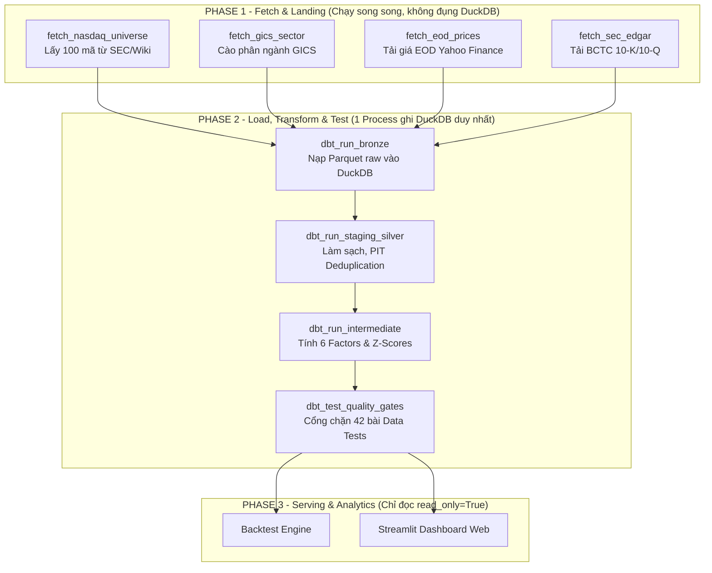

# Kiến trúc Điều phối Pipeline với Apache Airflow
**Dự án:** NASDAQ-100 Quantamental Factor Model & Portfolio Management  
**Engine:** Apache Airflow 2.9.3 (Docker) + DuckDB 1.1.0 + dbt-core 1.12.5  

---

## 1. Triết lý thiết kế & Chiến lược Hai Cơ sở Dữ liệu (Dual-Database)

Một trong những quyết định kiến trúc quan trọng nhất của dự án là phân định rạch ròi vai trò của 2 hệ quản trị cơ sở dữ liệu:

```
┌────────────────────────────────────────────────────────────────────────┐
│                   HỆ SINH THÁI DỮ LIỆU CỦA DỰ ÁN                       │
├───────────────────────────────────┬────────────────────────────────────┤
│  1. AIRFLOW METADATA DATABASE     │  2. QUANT DATA WAREHOUSE           │
│     (PostgreSQL Container)        │     (DuckDB - warehouse.duckdb)    │
├───────────────────────────────────┼────────────────────────────────────┤
│ • Nhiệm vụ: Quản lý trạng thái    │ • Nhiệm vụ: Lưu trữ & tính toán    │
│   nội bộ của Airflow.             │   toàn bộ dữ liệu định lượng.      │
│ • Lưu: Lịch sử TaskInstance,      │ • Lưu: Bronze, Staging, Silver,    │
│   DagRun, User admin, Connections,│   Intermediate (6 factor ratios),  │
│   XCom và Cron Schedules.         │   Gold (Pillars & Composite Score).│
│ • Cơ chế: RDBMS đa người dùng,    │ • Cơ chế: Columnar Embedded OLAP,  │
│   hỗ trợ multi-threading/process. │   tối ưu tính toán vector hóa.     │
└───────────────────────────────────┴────────────────────────────────────┘
```

> [!IMPORTANT]
> **Nguyên tắc Concurrency của DuckDB (Single-Writer):**  
> DuckDB cho phép đọc đồng thời từ nhiều process (`read_only=True`), nhưng **chỉ duy nhất 1 process được giữ quyền ghi** tại một thời điểm. Do đó, toàn bộ các tác vụ ghi vào DuckDB trong Airflow phải được điều phối tuần tự (Sequential), tuyệt đối không để 2 task dbt chạy song song đập vào cùng file `warehouse.duckdb`.

---

## 2. Nguyên lý Thực thi 2 Phase (Two-Phase Execution Flow)

Để tối ưu hóa thời gian xử lý và đảm bảo an toàn tuyệt đối cho DuckDB, pipeline được chia thành 2 Phase tách biệt:



1. **Phase 1 (Fetch & Landing):** Gọi API bên ngoài (SEC EDGAR, Yahoo Finance), kiểm tra Watermark ngày hôm nay, và ghi ra các file Parquet bất biến tại thư mục `data/raw/`. Giai đoạn này không đụng vào DuckDB nên các task có thể chạy song song tối đa.
2. **Phase 2 (Load & Transform):** dbt độc quyền nạp dữ liệu từ Parquet vào Bronze $\rightarrow$ Staging $\rightarrow$ Silver $\rightarrow$ Intermediate $\rightarrow$ Gold và chạy Data Tests.
3. **Phase 3 (Serving):** Streamlit Dashboard và Backtest Engine mở DuckDB ở chế độ `read_only=True` để phục vụ người dùng mà không gây xung đột lock.

---

## 3. Danh mục các DAG đã Triển khai

### DAG 1: `01_test_airflow_basic`
* **Mục đích:** Kiểm tra tính sẵn sàng của Airflow Scheduler, Worker và môi trường Linux container.
* **Cấu trúc:**
  - `task_python_hello` (`PythonOperator`): In thông điệp chào mừng và xác nhận worker thực thi.
  - `task_check_system` (`BashOperator`): Kiểm tra ngày giờ hệ thống và thông tin nhân Linux.
* **Quan hệ:** `task_python_hello >> task_check_system`.

### DAG 2: `test_duckdb_connect`
* **Mục đích:** Kiểm tra khả năng kết nối giữa Airflow Container và DuckDB Warehouse qua Docker Bind Mount (`/opt/airflow/data/warehouse.duckdb`).
* **Cơ chế an toàn:** Mở kết nối với tham số `read_only=True`.
* **Nhiệm vụ:**
  - Xác nhận file `warehouse.duckdb` tồn tại và kiểm tra dung lượng (~57.8 MB).
  - Liệt kê toàn bộ 6 bảng Intermediate: `int_rebalance_universe`, `int_momentum_ratio`, `int_growth_ratio`, `int_fcf_yield`, `int_sbc_ratio`, `int_earnings_surprise`.
  - Đếm và xác nhận đủ 20,200 dòng cho từng factor.

### DAG 3: `dbt_transformation_pipeline`
* **Mục đích:** Tự động hóa toàn bộ vòng đời Medallion Data Transformation trong dbt.
* **Cấu trúc 4 chặng tuần tự:**
  1. `dbt_run_bronze`: Nạp Parquet từ `data/raw/` vào 4 bảng Bronze (`bronze_company_facts`, `bronze_price_eod`, `bronze_sector`, `bronze_index_membership`).
  2. `dbt_run_staging_silver`: Làm sạch, chuẩn hóa kiểu dữ liệu, khử trùng lặp Point-in-time (PIT), điều chỉnh cổ tức.
  3. `dbt_run_intermediate`: Tính 6 factor định lượng, chuẩn hóa Z-Score trung hòa ngành và kẹp Winsorization $[-3.0, 3.0]$.
  4. `dbt_test_quality_gates`: Chạy toàn bộ **42 bài Data Tests** (unique, not_null, accepted_values, quan hệ khóa ngoại). Nếu có lỗi dữ liệu rác $\implies$ Chặn đứng pipeline.
* **Cờ đặc biệt:** `--no-partial-parse` để vô hiệu hóa cache parser giữa môi trường Windows (máy dev) và Linux (container).

### DAG 4: `nasdaq100_ingestion_pipeline` *(Đang hoàn thiện)*
* **Mục đích:** Tự động hóa khâu cào dữ liệu định kỳ sau phiên đóng cửa US EOD.
* **Nhiệm vụ:**
  - Cập nhật Universe 100 mã từ SEC & GitHub Constituents.
  - Cập nhật phân ngành GICS Sector.
  - Kiểm tra Watermark và tải dữ liệu Giá / BCTC còn thiếu.

---

## 4. Các Giải pháp Kỹ thuật Đã Xử lý (Troubleshooting & Best Practices)

Trong quá trình dựng hệ thống Airflow trên Windows Docker, các vấn đề kỹ thuật sau đã được giải quyết chuẩn mực:

| Sự cố thực tế | Nguyên nhân gốc rễ | Giải pháp chuẩn đã áp dụng |
|---|---|---|
| **Webserver báo `refused to connect`** | `airflow-webserver` khởi động cùng lúc với `airflow-init` khi DB Postgres chưa migrate xong. | Thêm `depends_on: airflow-init (service_completed_successfully)` và `restart: always` vào `docker-compose.yml`. |
| **Lỗi xem Task Log `403 Forbidden`** | Webserver và Scheduler tạo 2 Secret Key ngẫu nhiên khác nhau khi khởi động, không xác thực được log server cổng 8793. | Khai báo cố định `AIRFLOW__WEBSERVER__SECRET_KEY: "quant_airflow_secret_key_12345"` trong `x-airflow-env`. |
| **DuckDB File Lock trên Windows** | Mount trực tiếp 1 file đơn lẻ `./data/warehouse.duckdb` khiến DuckDB không tạo được file tạm `.wal`. | Mount toàn bộ thư mục `./data:/opt/airflow/data`. |
| **Thiếu thư viện trong Container** | Image chính thức `apache/airflow:2.9.3` không có sẵn DuckDB, dbt, Polars. | Dùng biến môi trường `_PIP_ADDITIONAL_REQUIREMENTS: "duckdb==1.1.0 dbt-duckdb polars yfinance"`. |
| **dbt KeyError `clean_string.sql`** | File cache `partial_parse.msgpack` tạo trên Windows dùng đường dẫn `\` gây xung đột khi chạy trên Linux. | Thêm cờ `--no-partial-parse` vào tất cả các lệnh dbt BashOperator. |
