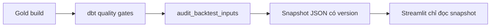

# Dashboard Gold — dùng trước khi xây backtest

Cập nhật 16/10/2026. Dashboard local đã triển khai bằng Streamlit trong `app/`, gồm sáu màn hình với giao diện research desk nền tối. Mục đích hiện tại là khám phá điểm Gold, so sánh mã, xem coverage và lý do thiếu dữ liệu. Kết quả lợi nhuận sẽ được nối vào sau khi backtest được kiểm chứng.

## 1. Chạy dashboard

Tại thư mục gốc project, dùng Python 3.11 trở lên:

```powershell
python -m pip install -r requirements-dashboard.txt
python -m streamlit run app/streamlit_app.py --server.port 8501
```

Mở [dashboard local](http://127.0.0.1:8501). Airflow tiếp tục dùng cổng 8080. Dashboard chỉ bind loopback trên máy, chưa publish.

`requirements-dashboard.txt` chỉ cài dependencies phục vụ app; không cần cài Airflow/dbt để xem một snapshot đã có. Để **tạo** snapshot từ warehouse, môi trường chạy audit vẫn cần DuckDB và code `research/`.

Nếu chưa có snapshot, chạy audit sau khi Gold đã build và tests đã qua:

```powershell
python -m research.backtest_quality
```

App hiển thị trạng thái chưa có dữ liệu nếu thiếu snapshot. App không tự chạy pipeline hay dùng dữ liệu mẫu để thay thế.

## 2. Luồng dữ liệu phục vụ app



`research.backtest_quality` dùng SQL trong `research/sql/backtest_inputs.sql`, đọc Gold và Intermediate trong cùng kết nối read-only rồi xuất:

- Các CSV/assessment của audit như trước.
- `data/reports/backtest_quality/snapshots/<snapshot_id>.json`: bản lưu theo nội dung.
- `data/reports/backtest_quality/dashboard_snapshot.json`: bản mới nhất, thay file nguyên tử.

Mỗi JSON chứa toàn bộ ticker–kỳ, assessment, policy tuổi dữ liệu, SQL và metadata Gold build. Không trộn CSV đang được ghi ở hai lần audit khác nhau. ID được hash từ toàn bộ payload, gồm thời điểm audit; hai lần audit có thể có ID khác nhau dù điểm số không đổi.

`audit_backtest_inputs` đã là task cuối DAG transformation; sau mỗi lần task thành công sẽ có snapshot mới. Không cần thêm web-server task vào DAG. Dashboard không import DuckDB, không truy vấn warehouse, không gọi API nguồn và không giữ `duckdb_access` pool.

App đọc bytes mỗi lần rerun, cache kết quả parse theo chính nội dung đó. Bấm **Đọc snapshot mới** để đọc bản đã xuất mới nhất; thao tác này không chạy audit. Snapshot quá 36 giờ có thông báo tuổi bản dữ liệu; thông báo này không kết luận pipeline đã fail. Trạng thái DAG mới nhất vẫn kiểm tra ở Airflow.

Muốn xem một bản lưu cụ thể trong PowerShell:

```powershell
$env:QUANT_DASHBOARD_SNAPSHOT = 'data/reports/backtest_quality/snapshots/<snapshot_id>.json'
python -m streamlit run app/streamlit_app.py --server.port 8501
```

Thay `<snapshot_id>` bằng file thật. Bỏ biến môi trường để quay lại bản mới nhất:

```powershell
Remove-Item Env:QUANT_DASHBOARD_SNAPSHOT -ErrorAction SilentlyContinue
```

## 3. Đọc từng màn hình

| Màn hình | Dùng để làm gì | Phạm vi |
| --- | --- | --- |
| Tổng quan | KPI cùng thay đổi so với kỳ trước, coverage từng pillar/ngành, phân bố composite và tối đa 8 signal đủ điều kiện có điểm cao nhất | Kỳ và ngành đang chọn; lịch sử chỉ tới kỳ đang chọn |
| Screener | Bốn pillar/composite, thứ hạng và thay đổi hạng; lọc, tìm ticker, tải CSV; chọn dòng rồi mở hồ sơ mã | Kỳ + ngành + điều kiện + tìm kiếm; hạng được tính trước hai bộ lọc cuối |
| Phân tích factor | Scatter hai pillar, tương quan Spearman, boxplot, heatmap coverage theo kỳ và điểm trung vị ngành | Kỳ + ngành; mỗi phép tính giữ số mẫu riêng |
| Hồ sơ mã | Điểm hiện tại, lịch sử bốn pillar/composite, tuổi và nguồn đầu vào; so sánh 2–4 mã bằng biểu đồ và bảng số | Các mã trong kỳ + ngành; lịch sử kết thúc tại kỳ đang chọn |
| Chất lượng dữ liệu | Xem nhóm thiếu FCF/SBC/Growth/Momentum/Quality, phần giao FCF–SBC, kiểm tra một mã và tuổi đầu vào | Kỳ + ngành; lịch sử mã chỉ tới kỳ đang chọn |
| Backtest | Checklist nối kết quả nghiên cứu sau này | Chưa có performance artifacts |

Ngày rebalance mặc định là kỳ mới nhất. Sector để trống nghĩa là tất cả, bao gồm mã chưa có sector. Lọc ngành không tính lại z-score hoặc composite. **Lịch sử hiển thị** chọn 12 kỳ, 24 kỳ hoặc toàn bộ; chỉ giới hạn biểu đồ lịch sử, không thay đổi kỳ đối chiếu thứ hạng.

### Cách dùng ba màn hình khám phá

1. Ở **Screener**, chọn kỳ/ngành, đọc composite rồi xem `Δ hạng`. Chọn một dòng và bấm mở hồ sơ để xem các pillar tạo nên điểm đó.
2. Ở **Hồ sơ mã**, xem trạng thái và lịch sử trước khi so sánh. Chọn 2–4 mã trong cùng phạm vi để đặt profile pillar và lịch sử composite cạnh nhau. Tải bảng CSV hoặc mở dữ liệu chi tiết khi cần đối chiếu.
3. Ở **Phân tích factor**, chọn cặp trục scatter, rê chuột để đọc ticker/sector/điểm. Dùng ma trận tương quan để xem các signal đang giống hay khác nhau; dùng boxplot và heatmap coverage để hiểu tập dữ liệu đằng sau chúng.

**Thứ hạng:** xếp composite giảm dần trong kỳ và ngành đang chọn; đồng điểm dùng hạng nhỏ nhất (1, 1, 3). `Δ hạng = hạng kỳ trước − hạng kỳ này`, số dương nghĩa là tăng hạng. Kỳ trước là kỳ liền trước trong lịch quan sát chung, không lùi xa hơn để tìm điểm còn thiếu. Hạng NULL khi chưa có điểm; thay đổi thành phần universe cũng có thể làm hạng thay đổi. Lọc đủ/chưa đủ hoặc tìm ticker không tính lại hạng.

**Spearman:** tương quan thứ hạng giữa hai điểm factor, dùng các mã có đủ cả hai điểm. Tooltip hiển thị số mẫu `n` cho từng cặp; `n < 3` hoặc một điểm không biến thiên thì ô để trống. Đây chưa phải IC giữa signal và lợi nhuận tương lai, chưa chứng minh khả năng dự báo.

**Lịch sử và màu:** mỗi pillar giữ cùng màu trên các trang; composite dùng màu sáng. Hồ sơ mã giữ khoảng trống khi mã vắng khỏi universe hoặc thiếu điểm, không nối xuyên khoảng thiếu. Heatmap coverage dùng thang 0–100%; ma trận tương quan dùng −1 đến +1; điểm chuẩn hóa dùng thang −3 đến +3. Các biểu đồ hỗ trợ tooltip, zoom, fullscreen và tải PNG qua thanh công cụ.

**Coverage = số mã `is_research_signal_eligible` / toàn bộ mã trong universe thuộc phạm vi đang chọn.** Mã thiếu điểm hoặc thiếu sector vẫn ở mẫu số khi chọn tất cả ngành. Khi xem nhiều kỳ, đơn vị là ticker–kỳ; không diễn giải tổng số dòng thành số công ty riêng biệt.

Điểm NULL giữ ô trống; điểm 0 vẫn là 0. CSV có đầy đủ lý do, tuổi input và provenance của đúng các dòng đang xem, không xuất giá signal thô. Mỗi nhóm lý do FCF/SBC là trạng thái ưu tiên trong SQL, chưa phải danh sách đầy đủ mọi lỗi của một mã. Các nhóm giữa nhiều input có thể chồng lấp. Momentum thiếu được gắn nhãn tổng quát từ `momentum_score IS NULL`, chưa quy kết một lỗi giá cụ thể.

Phần **Định nghĩa và nguồn dữ liệu** có policy, giới hạn tuổi, Gold invocation, số kiểm tra audit và SQL để kiểm chứng. `selected_build_validation` là kết quả của command Gold được ghi trong manifest, không thay cho trạng thái tất cả các lần chạy Airflow.

## 4. Định nghĩa giữ nguyên

- Value = 50% FCF yield z-score + 50% z-score SBC đã đảo dấu; cần đủ cả hai.
- Growth = z-score của revenue growth YoY + net margin năm.
- Momentum = z-score của adjusted month-end price t−1 / t−12 − 1.
- Quality hiện tại là **quarterly Net Income YoY growth proxy**, không phải thước đo chất lượng lợi nhuận tổng quát.
- Composite = 25% mỗi pillar; không tự chia lại trọng số khi thiếu pillar.
- Z-score theo ngành khi đủ mẫu, fallback toàn universe theo macro hiện tại; kẹp [-3, 3].

Đủ signal nghiên cứu còn cần CIK, sector, giá signal dương và input tuổi hợp lệ. Policy mặc định annual 550 ngày, shares 400 ngày, quarterly income 200 ngày; snapshot lưu giá trị thực tế của lần audit.

Lịch sử membership vẫn là observation theo tháng, sector hiện tại chưa PIT và còn giá lịch sử thiếu. Không suy luận “coverage cao = backtest đã đáng tin” hoặc “điểm cao = lợi nhuận cao”. Chi tiết ở [audit chất lượng dữ liệu](backtest-data-quality.md).

## 5. Tiếp tục backtest vào phiên làm việc sau

1. Chọn snapshot/dataset cố định và giữ mẫu số cùng lý do loại mã.
2. Chốt signal date → execution date, holding period, benchmark và phí.
3. Kiểm tra giá execution/exit, corporate actions và delisting; không loại mã dựa trên việc biết trước giá tương lai còn hay mất.
4. Viết CLI tạo một run gồm config, manifest, coverage/outcome diagnostics, positions, returns, turnover và equity curve.
5. Đối chiếu vài kỳ bằng tay, chạy tests chống look-ahead và reconcile NAV/chi phí.
6. Nối kết quả **cùng dataset/run** vào màn hình Backtest; từ coverage/outcome diagnostics mới ưu tiên cải thiện dữ liệu tiếp.

Mục này là thứ tự công việc, không tạo lịch tự động hoặc tự chạy vào ngày mai. Thiết kế sâu hơn: [roadmap sau Gold](post-gold-roadmap.md).

## 6. Kiểm tra

```powershell
python -m unittest discover -s tests -p 'test_dashboard*.py' -v
```

Tests kiểm tra snapshot nguyên tử + bản lưu, grain/manifest/policy không khớp, mẫu số theo ngành/kỳ, phần giao lý do, CSV đúng bộ lọc giữ NULL/0, các màn hình Streamlit, tìm kiếm rỗng và trạng thái snapshot thiếu/hỏng. Phần analytics kiểm tra đồng hạng, kỳ đối chiếu, pairwise correlation, số mẫu, điểm hằng, khoảng trống lịch sử và giới hạn ngày. Kiểm tra giao diện thật tại localhost bổ sung cho AppTest.

Các file chính khi phát triển tiếp:

| File | Vai trò |
| --- | --- |
| `app/streamlit_app.py` | Điều hướng, bộ lọc chung, tổng quan, screener, chất lượng dữ liệu và khung backtest |
| `app/ui.py` | Màu, CSS responsive và cấu hình biểu đồ dùng chung |
| `app/analytics.py` | Phép tính coverage, thứ hạng, phân bố, tương quan và lịch sử; không phụ thuộc UI |
| `app/factor_lab.py` | Các biểu đồ khám phá factor |
| `app/explorer.py` | Hồ sơ mã và so sánh nhiều mã |
| `app/data.py` | Đọc/kiểm tra snapshot, lọc dữ liệu và xuất CSV |

API sử dụng và đối chiếu với [Streamlit AppTest](https://docs.streamlit.io/develop/api-reference/app-testing/st.testing.v1.apptest), [caching](https://docs.streamlit.io/develop/api-reference/caching-and-state/st.cache_data) và [Plotly charts](https://docs.streamlit.io/develop/api-reference/charts/st.plotly_chart).
