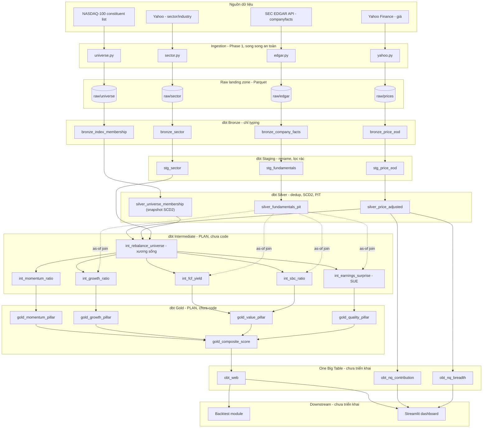
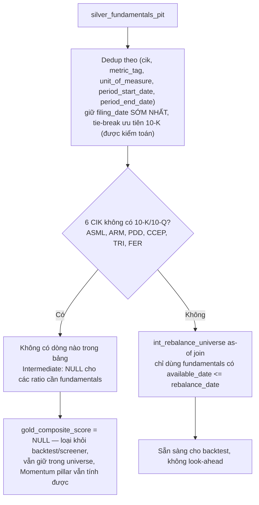
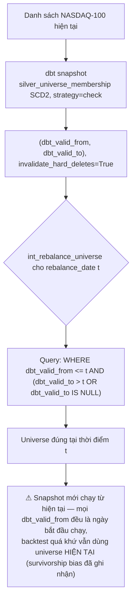
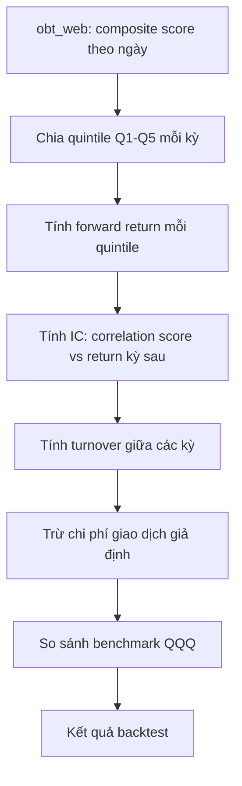

# Luồng dữ liệu (Data Flow) — Từ thô đến tinh

## 1. Luồng chi tiết từng bước (khớp code thật, cập nhật 2026-10-11)



**Bronze/Staging/Silver: đã code xong, parse sạch.** **Intermediate/Gold: đang ở giai đoạn plan**, tên model trong sơ đồ là tên dự kiến theo `intermediate-layer-plan.md`, chưa có file `.sql` thật.

## 2. Giải thích từng giai đoạn

| Giai đoạn | Input | Output | Việc chính |
| --- | --- | --- | --- |
| Ingestion (E+L) | EDGAR, Yahoo (giá + sector), danh sách NASDAQ-100 | Parquet raw (4 nguồn) | Fetch thô, validate schema (Pydantic), retry (tenacity), watermark theo file JSON per-ticker để không ingest trùng |
| Bronze | Parquet raw | `bronze_*` (4 bảng) | Load vào DuckDB qua `source()`, chỉ ép kiểu (`safe_cast`/`clean_string`), không sửa logic |
| Staging | `bronze_*` | `stg_*` (3 bảng — sector dừng ở đây) | Đổi tên cột sang snake_case, lọc rác rõ ràng (không phải quyết định nghiệp vụ) |
| Silver | `stg_*` | `silver_*` (3 bảng) | Dedup theo `(cik, metric_tag, unit, period_start, period_end)` giữ bản sớm nhất; tính `adjusted_close_price` chỉ từ cổ tức (không nhân split — Yahoo đã điều chỉnh sẵn); SCD2 cho universe qua `dbt snapshot` |
| Intermediate | `silver_*` | `int_*` | `int_rebalance_universe` làm xương sống (ticker × rebalance_date, chuẩn hoá về snake_case `ticker`/`cik`), các `int_*` còn lại as-of join vào đó, tính ratio rồi z-score sector-neutral (`n>=5`, fallback toàn universe) |
| Gold | `int_*` (đã z-score) | `gold_*` | Gộp 4 pillar, `gold_composite_score = 0.25×mỗi pillar` (equal-weight), NULL nếu thiếu pillar (vd 6 mã FPI không có fundamentals) |
| OBT | `gold_*`, `silver_*` | `obt_*` | **Chưa triển khai** — một bảng phẳng cho dashboard + bảng riêng phân tích NQ, tên dự kiến |
| Downstream | `obt_*` | Kết quả backtest, dashboard | **Chưa triển khai** — Backtest tính IC/turnover/quintile return; Streamlit đọc trực tiếp |

## 3. Airflow điều phối theo giai đoạn nào

| DAG | Giai đoạn phụ trách |
| --- | --- |
| `universe_membership_dag` | Ingestion → Bronze → Silver cho `silver_universe_membership` |
| `price_eod_dag` | Ingestion → Bronze → Silver cho `silver_price_adjusted` |
| `fundamentals_dag` | Ingestion → Bronze → Silver cho `silver_fundamentals_pit` |
| `sector_dag` | Ingestion → Bronze → Staging cho `stg_sector` (không cần lịch dày, sector ít đổi) |
| `dbt_transform_dag` | Staging → Intermediate → Gold, **1 task duy nhất gọi `dbt build`** (đã chốt dùng BashOperator, không dùng Cosmos task-per-model — chi tiết và lý do ở `execution-flow.md`) |
| `backtest_dag` | OBT → kết quả backtest |

Thứ tự thô → tinh luôn đi một chiều: **Raw Parquet → Bronze → Staging → Silver → Intermediate → Gold → OBT**. Không có bước nào ghi ngược lại tầng trước, giúp dễ debug: lỗi ở đâu chỉ cần chạy lại từ đúng tầng đó.

## 4. Data flow phân rã theo từng phần phức tạp

### 4.1 Ingestion & Idempotency

```mermaid
graph TD
    A[Start ingestion job] --> B{Check watermark<br/>file JSON per-ticker, đã cập nhật hôm nay chưa?}
    B -- Chưa / cũ --> C[Gọi API nguồn<br/>EDGAR hoặc Yahoo]
    B -- Đã cập nhật --> Z[Skip, không gọi API]
    C --> D{Rate limit OK?<br/>EDGAR 10 req/s}
    D -- Vượt limit --> E[tenacity retry + backoff]
    E --> C
    D -- OK --> F[Validate schema Pydantic]
    F -- Lỗi schema --> G[Log lỗi, không ghi raw]
    F -- Hợp lệ --> H[Ghi Parquet raw]
    H --> I{run() trả về True cho CẢ 2<br/>edgar + yahoo?}
    I -- Có --> J[Set watermark]
    I -- Không --> K[Không set — retry lại ở lần chạy sau]
```

*Chạy lại job này nhiều lần trong ngày không tạo dữ liệu trùng. `run()` chỉ trả `True` khi ghi thành công thật, tránh watermark bị set sai khi fetch lỗi ngầm.*

### 4.2 Point-in-time fundamentals join



### 4.3 Universe membership (SCD2) & truy vấn point-in-time



### 4.4 Factor → Composite score

```mermaid
graph TD
    A[int_* ratio factors] --> B[Winsorize outlier từng factor]
    B --> C{Sector có n >= 5 mã<br/>không NULL cho factor đó? count(column), không phải count(*)}
    C -- Có --> D[Z-score trong sector]
    C -- Không --> E[Z-score toàn universe - fallback<br/>áp dụng cho Utilities 4, Energy 2, 3 sector còn lại 1 mã]
    D --> F{Check tương quan chéo<br/>giữa factor - VIF}
    E --> F
    F -- Cao --> G[Orthogonalize / loại bớt factor trùng]
    F -- OK --> H[Gộp thành pillar<br/>Growth / Value / Momentum / Quality]
    G --> H
    H --> I["gold_composite_score = 0.25×mỗi pillar<br/>(equal-weight, đã chốt)"]
    I --> J{Thiếu pillar nào?<br/>vd 6 mã FPI không có 10-K/10-Q}
    J -- Thiếu --> K["composite_score = NULL<br/>KHÔNG coalesce về 0, loại khỏi backtest/screener"]
    J -- Đủ cả 4 --> L[composite_score hợp lệ]
```

### 4.5 Backtest



*Chưa triển khai — giữ nguyên plan từ `analytics-flow.md`.*

### 4.6 Airflow DAG dependency & DuckDB concurrency

Chi tiết đầy đủ (nguyên lý tách 2 phase, lý do bỏ Cosmos, cơ chế Pool) đã chuyển hẳn sang `execution-flow.md` — không lặp lại ở đây để tránh 2 nguồn thông tin lệch nhau theo thời gian.