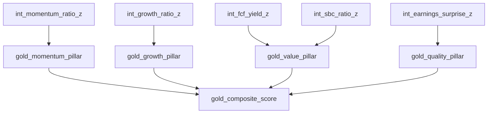

# Intermediate Layer — Plan

> Plan này mô tả thiết kế ban đầu. SQL mẫu universe/FY và nhãn TTM bên dưới đã được thay thế bởi [semantics-and-universe.md](semantics-and-universe.md): kiểm tra cả hai đầu membership window, annual USD duration 330–400 ngày, availability +1 ngày và ghép các fact cùng kỳ. Không dùng lại mẫu bỏ `dbt_valid_from` hoặc chỉ lọc `FY`.

## 1. Thứ tự triển khai

| Phase | Việc | Trạng thái / Phụ thuộc |
| --- | --- | --- |
| A | Mở rộng tag EDGAR (OCF, Capex, SBC, 3 Revenue fallback tags) trong `edgar.py`, chạy lại ingestion | **ĐÃ XONG** — Đã nạp thành công 11 tags, độ phủ Doanh thu đạt 95/104 CIKs |
| B | `bronze_sector` + `stg_sector` (đọc mapping sector) | **ĐÃ XONG** — 100/100 mã có Sector, 40/40 dbt tests PASS |
| C | `int_rebalance_universe` (xương sống as-of join) | **SẴN SÀNG LÀM NGAY** — Cần `silver_universe_membership`, `silver_price_adjusted` |
| D | `int_momentum_ratio` | **SẴN SÀNG LÀM NGAY** — Chỉ cần C và giá |
| E | `int_growth_ratio`, `int_fcf_yield`, `int_sbc_ratio`, `int_earnings_surprise` (SUE) | **SẴN SÀNG LÀM NGAY** — Đã có đủ tag ở Silver |
| F | macro `zscore_sector_neutral` áp vào từng `int_*` | **SẴN SÀNG LÀM NGAY** — Đã có Sector sạch ở Staging |

Toàn bộ các điều kiện tiên quyết (Phase A & B) đã hoàn tất. Có thể tiến hành triển khai các model Intermediate ngay lập tức.

## 2. `int_rebalance_universe` — xương sống as-of join

**Grain: 1 dòng = 1 ticker × 1 rebalance_date** (ngày giao dịch cuối cùng mỗi tháng).

**Vì sao cần bảng này:** giá ra theo ngày, fundamentals ra theo quý/năm, universe đổi theo tháng — 3 nhịp độ khác nhau. Không có 1 "lưới" chung thì không model nào biết chính xác ngày nào cần tính z-score cắt ngang. `int_rebalance_universe` chính là lưới đó — mọi `int_*` khác **as-of join** vào đây, không tự tạo lại danh sách ngày/ticker riêng.

**Quy ước naming (chốt tại đây, áp dụng cho mọi model từ Intermediate trở đi):** nguồn upstream case không đồng nhất (`silver_universe_membership` còn PascalCase `"Ticker"`/`"CIK"` vì snapshot `select *`; `silver_price_adjusted`/`stg_sector` đã snake_case). `int_rebalance_universe` là "cửa khẩu" chuẩn hoá lần cuối — alias về `ticker`/`cik` thường ngay tại đây, từ Intermediate trở đi không model nào cần biết nguồn gốc case nữa.

**Cơ chế tự nhiên cho 6 mã FPI (ASML, ARM, PDD, CCEP, TRI, FER):**
- Được giữ nguyên trên lưới `int_rebalance_universe` (vì lưới chỉ cần Giá + Universe).
- Khi các model cần Fundamentals (`int_growth_ratio`, `int_fcf_yield`, ...) dùng `LEFT JOIN LATERAL`, 6 mã này tự động trả về 0 dòng khớp $\rightarrow$ giá trị thành `NULL`.
- **Lưu ý nguyên tắc sống còn:** Tuyệt đối **KHÔNG dùng `COALESCE(..., 0)`** cho các tỷ số tài chính. Giá trị `0` là một kết quả kinh doanh có thật (ví dụ lợi nhuận = 0), trong khi thiếu dữ liệu phải là `NULL`. Nhầm lẫn sẽ làm sai lệch z-score và `gold_composite_score`.

```sql
{{ config(materialized='table') }}

with rebalance_dates as (
    -- Ngày giao dịch cuối cùng mỗi tháng — lấy từ chính dữ liệu giá,
    -- tự động bỏ qua cuối tuần/ngày nghỉ vì không có dòng giá cho ngày đó
    select
        date_trunc('month', trade_date) as rebalance_month,
        max(trade_date) as rebalance_date
    from {{ ref('silver_price_adjusted') }}
    group by 1
)

select
    rd.rebalance_date,
    u."Ticker" as ticker,
    u."CIK" as cik,
    s.sector  -- đã snake_case sẵn từ stg_sector, không cần alias lại
from rebalance_dates rd
join {{ ref('silver_universe_membership') }} u
    -- Point-in-time: V1 áp dụng snapshot hiện tại cho lịch sử (theo Giới hạn 8 của architecture.md).
    -- Chỉ lọc bản ghi chưa bị xóa trong tương lai. Tuyệt đối KHÔNG kẹp 'u.dbt_valid_from <= rd.rebalance_date'
    -- vì snapshot mới chạy lần đầu ở hiện tại (2026), kẹp như vậy sẽ làm mất sạch toàn bộ lịch sử 2010-2026.
    on (u.dbt_valid_to > rd.rebalance_date or u.dbt_valid_to is null)
left join {{ ref('stg_sector') }} s
    on s.ticker = u."Ticker"
```

Gộp sector ngay vào xương sống — mọi `int_*` và macro `zscore_sector_neutral` phía sau chỉ cần đọc cột `sector` có sẵn, không phải tự join `stg_sector` riêng ở từng model.

**Mọi `int_*` khác dùng chung 1 pattern as-of join vào bảng này**, ví dụ trích xuất Doanh thu TTM (với Revenue Fallback Chain tích hợp mức độ ưu tiên chuẩn xác):

```sql
select
    r.rebalance_date,
    r.ticker,
    r.sector,                               -- Mang theo sector để phục vụ macro z-score
    f.metric_value as revenue_ttm
from {{ ref('int_rebalance_universe') }} r
left join lateral (
    select f.metric_value
    from {{ ref('silver_fundamentals_pit') }} f
    where f.cik = r.cik
      and f.metric_tag in (
          'Revenues',
          'RevenueFromContractWithCustomerExcludingAssessedTax',
          'SalesRevenueNet'
      )
      and f.fiscal_period = 'FY'
      and f.available_date <= r.rebalance_date  -- point-in-time, không look-ahead
    order by 
        f.period_end_date desc,             -- 1. Ưu tiên kỳ báo cáo mới nhất
        case f.metric_tag                   -- 2. Ưu tiên tag chính thống trước tag fallback
            when 'Revenues' then 1
            when 'RevenueFromContractWithCustomerExcludingAssessedTax' then 2
            when 'SalesRevenueNet' then 3
        end asc,
        f.available_date desc               -- 3. Nếu cùng kỳ & cùng tag thì lấy bản công bố mới nhất
    limit 1
) f on true
```

Mẫu `left join lateral ... order by ... limit 1` này là **pattern cố định dùng lại cho mọi factor fundamentals** — chỉ đổi `metric_tag`. 

> **Lưu ý cấu trúc hoàn chỉnh của `int_growth_ratio` (Rule of 40):**
> Model tăng trưởng không chỉ lấy 1 con số doanh thu, mà cần:
> 1. Doanh thu năm nay ($Rev_t$) và Doanh thu năm trước ($Rev_{t-1}$) $\rightarrow$ $Growth_{YoY} = \frac{Rev_t - Rev_{t-1}}{|Rev_{t-1}|}$.
> 2. Lợi nhuận ròng năm nay ($NI_t$) $\rightarrow$ $Margin = \frac{NI_t}{Rev_t}$.
> 3. $RuleOf40_{raw} = Growth_{YoY} + Margin$.
> 4. Áp macro Z-Score theo ngành: `{{ zscore_sector_neutral('rule_of_40_raw', 'sector', 'rebalance_date') }} as growth_zscore`.

## 3. SUE — công thức cụ thể & Phân định nhịp báo cáo

```
SUE_t = (EPS_t − EPS_{t-4quý}) / stddev(EPS_t − EPS_{t-4quý} của 8 quý liền trước)
```

**Phân định ranh giới nhịp báo cáo:**
- **Growth / Value / Quality (TTM annual):** V1 áp dụng quy tắc đơn giản hóa — chỉ dùng số liệu năm (`fiscal_period = 'FY'` từ form 10-K), chấp nhận số liệu đứng yên 11/12 tháng.
- **Riêng SUE (`int_earnings_surprise`):** Dùng dữ liệu **theo từng quý** (gồm cả 10-Q và 10-K) vì bản chất kinh tế của Earnings Surprise là sự bất ngờ theo quý so với cùng kỳ năm trước. Dữ liệu quý đã có sẵn đầy đủ trong `silver_fundamentals_pit` (độ sâu lịch sử nhiều năm), đủ điều kiện tính `stddev` qua window function.

## 4. Danh sách `int_*` sau khi cân nhắc dữ liệu thật

| Model | Cần gì | Trạng thái |
| --- | --- | --- |
| `int_momentum_ratio` | Chỉ giá (`silver_price_adjusted`) | Sẵn sàng làm ngay |
| `int_growth_ratio` (Rule of 40) | Revenue fallback + Net Income | Sẵn sàng làm ngay (đủ data) |
| `int_fcf_yield` | OCF − Capex, Market Cap | Sẵn sàng làm ngay (đủ data) |
| `int_sbc_ratio` | SBC / Revenue fallback | Sẵn sàng làm ngay (đủ data) |
| `int_earnings_surprise` (SUE) | EPS lịch sử các quý | Sẵn sàng làm ngay (đủ data) |

## 5. Macro `zscore_sector_neutral` — vị trí dùng

Áp **sau cùng**, trên từng `int_*` đã ra ratio thô, dùng `count(column_name)` (không phải `count(*)`) và ngưỡng `n >= 5` đã chốt — 5/11 sector sẽ rơi vào fallback z-score toàn universe (Utilities 4, Energy 2, 3 sector còn lại 1 mỗi nhóm), đúng như dữ liệu thật đã kiểm.
Việc áp Z-score ngay tại cuối mỗi `int_*` đảm bảo nguyên tắc Clean Architecture: mỗi model chịu trách nhiệm trọn vẹn từ ratio thô $\rightarrow$ z-score chuẩn hóa. Lớp Gold chỉ làm phép tổng hợp trọng số đại số tuyến tính.

## 6. Việc còn mở, giải pháp chốt

- **Fallback chain Revenue:** Xử lý trực tiếp trong subquery của `LATERAL JOIN` qua `CASE metric_tag ... ORDER BY priority ASC` (như mẫu mục 2). Cách này giữ nguyên vẹn `silver_fundamentals_pit` chuẩn 1:1 với US-GAAP tags gốc, không cần tạo bảng trung gian.
- **Macro cho pattern `left join lateral`:** Viết khi có từ 3 `int_*` fundamentals trở lên để tránh trừu tượng hóa quá sớm.

## 7. Gold layer — quan hệ phụ thuộc (plan, chưa code)



| Gold model | Input (`int_*` đã z-score) | Công thức |
| --- | --- | --- |
| `gold_momentum_pillar` | `int_momentum_ratio` | 1 factor → gán thẳng, không cần gộp |
| `gold_growth_pillar` | `int_growth_ratio` | 1 factor → gán thẳng |
| `gold_value_pillar` | `int_fcf_yield`, `int_sbc_ratio` | Trung bình cộng 2 factor đã z-score |
| `gold_quality_pillar` | `int_earnings_surprise` (SUE) | 1 factor → gán thẳng |
| `gold_composite_score` | 4 pillar trên | `0.25×mỗi pillar` — NULL nếu thiếu bất kỳ pillar nào (không coalesce về 0) |

**Lưu ý khi grain đã thống nhất:** vì mọi `int_*` đều cùng grain `(ticker, rebalance_date)` nhờ `int_rebalance_universe`, Gold chỉ cần `JOIN ... ON ticker AND rebalance_date` giữa các `int_*` — không cần as-of join nữa ở tầng này, as-of join chỉ xảy ra 1 lần duy nhất khi `int_*` kéo dữ liệu từ Silver.
