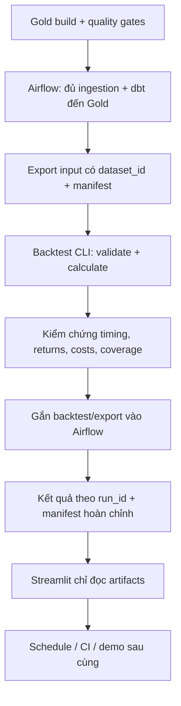
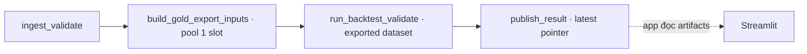

# Roadmap sau Gold — Airflow → Backtest → Streamlit

**Điều chỉnh thứ tự 15/10/2026:** theo lựa chọn hiện tại, đã dựng Streamlit xem Gold/coverage/chất lượng dữ liệu trước. Xem [dashboard-guide.md](dashboard-guide.md) để chạy app và nối snapshot sau audit. Phần performance của dashboard chờ backtest CLI được kiểm chứng. Các mục bên dưới giữ vai trò thiết kế tham khảo; trạng thái triển khai thực tế xem hướng dẫn runtime và dashboard.

Cập nhật **15/10/2026**, dựa trên code trong workspace. Đây là **plan để tự triển khai**, chưa sửa DAG, viết backtest, dựng app hay chạy job. Các tên task/module/output mới bên dưới là đề xuất.

**Mẫu để đọc và viết theo:** [Gold tests — mục 13](#13-mẫu-tests-cần-thêm-sau-gold), [Airflow DAGs — mục 14](#14-mẫu-airflow-để-hình-dung-cách-điều-phối). Code trong các mục này chỉ nằm ở tài liệu, chưa được đưa vào models/tests/dags.

## 1. Làm gì sau khi Gold build thành công?

**Thứ tự đề xuất:**

1. Xác nhận Gold có dữ liệu đúng và có quality gates.
2. Hoàn thiện **Airflow tối thiểu**: fetch đủ đầu vào → dbt đến Gold → kiểm tra → export input phiên bản cố định.
3. Viết **backtest CLI** trên dataset đã chụp, chạy và kiểm chứng độc lập.
4. Khi backtest ổn: **gắn backtest và export kết quả vào Airflow**.
5. Dựng **Streamlit đọc kết quả có sẵn**.
6. Cuối cùng mới lên lịch tự động, làm CI và cân nhắc publish demo.

Airflow giúp batch job chạy đúng thứ tự và có log/retry. Backtest tạo bằng chứng nghiên cứu. Streamlit trình bày bằng chứng đó. Vì vậy UI performance nên đi sau khi engine và output contract của backtest ổn định.

Có thể tạo một trang local nhỏ để nhìn Gold trong lúc phát triển, nhưng milestone chính của dashboard đến sau backtest. Chưa cần tối ưu UI, dynamic task mapping hay thêm Cosmos trong chặng đầu.



## 2. Điều kiện bắt đầu — Gold success chưa đủ

| Kiểm tra | Mục tiêu |
| --- | --- |
| 5 models có SELECT hợp lệ | Growth, Momentum, Value, Quality, Composite |
| Grain unique | Một ticker × rebalance_date, không nhân dòng khi join |
| Composite rule | Đủ 4 pillar mới tính; NULL không thay thành 0 |
| Coverage theo tháng | Biết bao nhiêu mã thiếu CIK/giá/sector/factor và lý do |
| Metadata | membership_quality và identifier_quality còn giữ |
| Domain definition | Quality hiện dùng earnings-growth proxy nếu chọn mẫu MVP, không gọi là SUE chuẩn |
| Universe scope | Giữ nhãn effective / monthly_observation / live_observation; không coi observation là effective-date PIT |
| Tháng hợp lệ | Không tính tháng chưa hoàn tất thành một tháng rebalance đầy đủ |

**Đầu ra Gate 0:** Gold đã build, tests pass, có coverage report và mô tả giới hạn. Bạn hiểu rõ dataset nào đủ dữ liệu để xếp hạng trước khi xây chiến lược.

Không đặt mục tiêu Sharpe cao hoặc IC dương làm gate kỹ thuật. Engine có thể đúng và chiến lược không có hiệu quả; đó vẫn là kết quả nghiên cứu hợp lệ.

## 3. Airflow hiện có gì và còn thiếu gì?

| Thành phần hiện tại | Đang làm | Cần bổ sung sau Gold |
| --- | --- | --- |
| dags/advanced_quant_pipeline.py | Current universe → sector → kiểm tra 2 files → trigger dbt DAG | Fetch giá, EDGAR, benchmark; historical ticker coverage; manifest/freshness |
| dags/dbt_transformation_pipline.py | Bronze → seed/snapshot/Staging/Silver → Intermediate → tests | Gold build, input export, params nhất quán, isolation các run |
| TriggerDagRunOperator | wait_for_completion=False; reset_dag_run=True; chưa truyền conf | Truyền run config; theo dõi lỗi child DAG; rerun có run_id rõ |
| DAG schedule | Cả hai DAG đang schedule_interval=None | Giữ manual trong MVP; schedule sau kiểm chứng |
| DuckDB | ../data/warehouse.duckdb, một file dùng chung | Điều phối tất cả processes truy cập file, kể cả reader |
| test_duckdb_connect | Đọc live warehouse với read_only=True | Tham gia cơ chế phối hợp hoặc đọc bản snapshot |
| Container dependencies | Airflow 2.9.3, cài thêm một phần dependencies khi startup | Bộ dependency được build/pin và đủ cho ingestion/backtest |
| backtest/ và app/ | Hiện mới có package skeleton | CLI engine và app riêng, triển khai ở các chặng sau |

Tên Momentum trong workspace hiện là `gold_momentum_pillar.sql`; Composite là `gold_compose_score.sql`. Dùng tên thực tế này trong selection/refs, không lấy lại tên cũ từ plan.

## 4. Chặng A — Airflow tối thiểu đến Gold

### A1. Cố định runtime và đường dẫn

1. Dùng một bộ versions được kiểm chứng cho DuckDB/dbt/Polars/Pydantic/requests/tenacity/yfinance.
2. Kiểm tra container import được các modules ingestion, chạy được dbt và thấy đúng volumes.
3. Kiểm tra path root `/opt/airflow`, raw `/opt/airflow/data/raw`, project `/opt/airflow/dbt` và warehouse `/opt/airflow/data/warehouse.duckdb`.
4. Khi triển khai backtest, mount package `backtest/` vào container; compose hiện chưa có mount riêng này.
5. Hướng đến custom image hoặc lock/constraints được kiểm chứng, thay vì mỗi lần start container lại cài floating dependencies khác nhau.

**Đầu ra:** cùng command chạy được trên local và môi trường Airflow. Không nâng Airflow version trong cùng thay đổi chỉ để thêm một task Gold.

### A2. Fetch đủ đầu vào

Thiết kế task ở mức batch trước; bắt đầu tuần tự hoặc concurrency thấp, dễ đọc log.

| Task đề xuất | Nhiệm vụ | Output cần kiểm tra |
| --- | --- | --- |
| fetch_current_universe | Cập nhật current tickers/CIK | Universe file + số ticker |
| prepare_research_universe | Hợp current + ticker history; audit CIK | Danh sách fetch và unresolved identifiers |
| fetch_prices | Tải giá tất cả ticker cần nghiên cứu | Files, trading date range, failures |
| fetch_fundamentals | Tải EDGAR theo unique CIK đã map | Facts files, filing range, failures |
| fetch_sector | Sector cho danh sách nghiên cứu | Sector coverage, không chỉ file nonzero |
| fetch_benchmark | Tải QQQ riêng | Price coverage trùng các execution dates cần dùng |
| verify_landing_zone | Xác nhận schema, keys, freshness, coverage | Ingestion manifest và danh sách exceptions |

QQQ không được tự thêm thành một thành viên NASDAQ-100 trong grid; nó là benchmark. Giá QQQ đi qua cùng quy ước adjusted-return prices với chiến lược. Chốt chỗ lưu benchmark riêng hoặc tái sử dụng price source nhưng bảo đảm không tạo membership QQQ.

History seed không nhất thiết refresh mỗi ngày. Refresh theo cadence riêng/manual và ghi seed hash/version; không biến observation thành effective bằng đổi nhãn.

**Điểm cần sửa ở adapter contract:** main/adapter hiện có chỗ log lỗi rồi return False/return bình thường. Wrapper Airflow phải kiểm tra outcome, và raise khi vi phạm policy; process exit 0 không đủ chứng minh ingestion thành công. Nếu một số mã delisted thiếu giá, xuất exception report rõ ràng thay vì mặc định task success rồi giấu thiếu hụt.

### A3. Truyền một run config nhất quán

Config đề xuất cho cả ingestion, transformation và backtest:

| Trường | Dùng để làm gì? |
| --- | --- |
| pipeline_run_id | Liên kết logs/artifacts của một lần chạy |
| data_as_of | Cutoff dữ liệu; không dùng giờ chạy job thay cho thời điểm dữ liệu |
| allow_observed_universe | Research observation mode hoặc strict effective-date mode |
| research_start / research_end | Phạm vi nghiên cứu đề xuất, clip vào coverage thực tế |
| dataset_id | Phiên bản input đã chụp để backtest chạy lại |
| backtest_config_id | Phiên bản phương pháp/chi phí/execution conventions |

Các tham số này **chưa được hỗ trợ đầy đủ trong code hiện tại**. Đặc biệt grid đang dùng CURRENT_DATE; replay theo data_as_of cần thêm cutoff có chủ đích và ghi nó vào manifest. Backfill scheduler không tự biến live API/current snapshot thành historical PIT.

Nếu giữ hai DAG, truyền cấu hình qua `conf`, dùng runtime params được validate đúng kiểu Boolean/date. Kiểm tra `dag_run_conf_overrides_params` thay vì giả định conf tự ghi đè mọi default. [Airflow 2.9.3 Params](https://airflow.apache.org/docs/apache-airflow/2.9.3/core-concepts/params.html)

Chọn chờ child DAG hoàn thành hoặc đặt downstream trực tiếp trong transformation DAG. Parent chỉ trigger thành công chưa có nghĩa dbt/backtest đã success. Khi dùng wait_for_completion, định nghĩa success/failure states và tránh giữ slot tài nguyên warehouse trong task chỉ chờ child. Reset một existing DagRun không thay conf của run cũ; rerun với config khác nên có run_id mới. [TriggerDagRunOperator 2.9.3](https://airflow.apache.org/docs/apache-airflow/2.9.3/_api/airflow/operators/trigger_dagrun/index.html)

### A4. Thêm Gold và quality gates

Luồng target tối thiểu:

```text
verify_landing_zone
    → Bronze
    → history seed + snapshot + Staging/Silver
    → Intermediate build/tests
    → Gold build/tests
    → final quality/coverage audit
    → export frozen backtest inputs
```

MVP có thể giữ task theo layer như code hiện tại. Để giảm các khoảng trống giữa processes trong phase warehouse, nên cân nhắc một task batch thực hiện chuỗi dbt rồi export input, giữ quyền truy cập file suốt phase. Chi tiết lựa chọn này thuộc implementation; không cần Cosmos task-per-model để đạt milestone.

Nếu hard test fail: chặn export phiên bản mới. Warning coverage: xuất manifest cảnh báo và áp policy đã định, không âm thầm loại tickers rồi coi dữ liệu sạch.

### A5. DuckDB và chống run chồng nhau

- Với mô hình file DuckDB đang dùng, không để dbt writer và backtest/IDE reader khác process cùng mở live database. `read_only=True` không tự bảo đảm reader có thể chạy song song với writer. Đọc từ artifacts đã chụp là hướng đơn giản cho downstream. [DuckDB concurrency](https://duckdb.org/docs/current/connect/concurrency)
- Dùng shared Airflow pool, đề xuất `duckdb_access`, **1 slot**, cho mọi task mở live warehouse, kể cả task đọc kiểm tra. Pool giới hạn tasks được gán vào nó, không khóa process IDE/terminal bên ngoài. [Airflow Pools](https://airflow.apache.org/docs/apache-airflow/2.9.3/administration-and-deployment/pools.html)
- `max_active_runs=1` giúp một DAG tránh các runs chồng nhau; hai DAG khác nhau vẫn cần phối hợp. Chỉ cấp pool từng task không đủ bảo đảm toàn bộ pipeline run A không bị run B xen giữa các layer.
- MVP nên có một đường orchestration chính với run tuần tự và phase warehouse giữ resource đến khi input export hoàn tất; các lần direct-trigger riêng cần dùng cùng cơ chế.
- Không để ingestion run mới ghi đè Parquet trong lúc transformation run cũ đọc. Dùng landing/version directory theo run hoặc khóa phase và ghi file atomic; nguyên tắc đầu vào cố định áp dụng cả ngoài DuckDB.
- Mọi connection cần đóng khi xong hoặc khi task lỗi. Không xử lý lock bằng cách tùy tiện xóa database/WAL.

**Gate A:** một manual run tải đủ đầu vào theo policy, build đến Gold, giữ config/provenance, export input đầy đủ; chạy lại cùng frozen input không tạo duplicates. Lỗi upstream không publish phiên bản mới, và không có database lock khi các tasks đúng quy trình.

## 5. Chặng B — Backtest CLI trước dashboard

### B1. Chốt research contract trước khi code

Các lựa chọn dưới đây là **baseline đề xuất**, cần được ghi thành config/version. Chưa phải kết quả đã thực hiện.

| Quyết định | Baseline MVP |
| --- | --- |
| Signal | composite_score monthly, dùng scores có sẵn ở Gold |
| Universe | Membership theo window có coverage; giữ nhãn observation/identifier quality |
| Eligibility | Đủ 4 scores, giá execution hợp lệ; audit từng exclusion |
| Rebalance | Hàng tháng |
| Execution | Close của phiên giao dịch đầu tiên **sau** signal rebalance_date |
| Holding window | Entry close kỳ t đến entry close kỳ t+1 |
| Ranking | Composite tăng dần, ticker làm tie-break deterministic |
| Buckets | Q1 thấp nhất → Q5 cao nhất; số mã các nhóm lệch tối đa 1 khi đủ số quan sát |
| Weight | Equal-weight tại entry; giữa hai rebalances weights drift theo returns |
| Chiến lược chính | Long-only Q5, thêm Q1–Q5 để quan sát monotonicity |
| Diagnostic spread | Q5 − Q1, ghi rõ gross factor spread; chưa mô phỏng short borrow/margin/financing |
| Benchmarks | QQQ total-return proxy; thêm equal-weight eligible universe để tách tác động selection/weighting |
| Costs | Cấu hình cost bps trên traded notional; chạy baseline + sensitivity scenarios |
| Out-of-sample | Khi đủ lịch sử, chốt chronological split trước tuning; không tối ưu weights trên toàn mẫu |

Gold là monthly scores: **không resample lại một bảng OBT daily chưa tồn tại** như plan analytics cũ. Dùng Gold trực tiếp, lấy daily adjusted prices cho execution/return path.

QQQ là benchmark bối cảnh thị trường, còn equal-weight eligible universe giúp so sánh trên population gần chiến lược hơn. Q5−Q1 không cùng mức exposure với long-only QQQ; không gọi chênh lệch hai series này là alpha đã điều chỉnh rủi ro.

Với history observation từ 2023 trở đi, số kỳ có thể ngắn; báo cả số tháng/số mã và hạn chế inference. Các horizon 6M/12M có nhiều kỳ overlap, không xem mỗi observation là độc lập trong thống kê.

### B2. Execution lag phải nhất quán

```text
Ngày signal t: đọc Gold đã biết tại close của rebalance_date.
Phiên kế tiếp: vào danh mục tại close theo convention MVP.
Kỳ kế tiếp: signal mới hình thành.
Phiên sau signal mới: thoát/đổi danh mục tại close.
```

Không chọn ticker bằng score ở close t rồi giả định đã mua được ngay close t. Nếu sau này muốn next-open, cần thêm open-price adjusted convention tương ứng và đổi baseline rõ ràng.

Forward return một holding window: `P_adj(exit) / P_adj(entry) - 1`. Benchmark phải dùng cùng entry/exit dates. Kỳ cuối chưa có exit price → incomplete/pending, không return 0 và không đưa vào summary completed periods.

Membership t chỉ quyết định danh mục tại signal t. Một mã rời index trong holding window vẫn cần theo dõi position/exit theo policy; không xóa nó khỏi danh mục chỉ vì tháng sau không còn membership.

### B3. Giữ missingness và price gaps có thể kiểm toán

1. Lập base coverage grid trước ranking và thống kê số mã có score.
2. Lưu reason cho score thiếu, identifier chưa xác minh hoặc không có giá entry.
3. Không dùng thông tin future return để chọn stocks hoặc lọc universe.
4. Giá exit thiếu của một position đã mua không được silently drop hay chia lại weights của stocks còn lại.
5. Phân biệt pending kỳ cuối, dữ liệu lỗi, ngừng giao dịch và delisting; ghi status theo quy tắc có nguồn.
6. Nếu thiếu thông tin exit/delist làm kết quả không xác định, đánh dấu period invalid/partial và công bố coverage; không nối equity như thể không có gap. Có thể thêm scenario penalty sau, ghi rõ assumption và thời điểm nhận diện.
7. Tiền của position không trade được cần policy cash/fill rõ, không tùy ý đổi weights để dùng hết vốn.

Không dùng penalty cho mọi trường hợp thiếu giá; thiếu API history chưa chứng minh một ticker đã delist. Baseline hoàn thành phải cho thấy các gaps thay đổi kết luận đến mức nào.

### B4. Turnover và costs

Theo từng kỳ, tính pre-trade weights sau drift từ kỳ trước, rồi so với target equal weights mới. Bao gồm các ticker bị bán về 0; cash được theo dõi riêng.

```text
traded_weight = Σ_stock abs(target_weight − pretrade_weight)
one_way_turnover = 0.5 × traded_weight
cost_return = traded_weight × cost_bps / 10_000
net_return ≈ gross_return − cost_return
```

Đây là convention cost trên tổng notional mua + bán; một rotation bán 100% rồi mua 100% có traded_weight=2. Initial entry từ cash có traded_weight=1; báo separately inception turnover để tránh nhầm convention. Không dùng % thay đổi thành viên làm turnover nếu weights đã drift.

Cost formula là approximation theo NAV đầu kỳ. Khi dựng daily NAV, charge costs đúng ngày trade và reconcile với period returns; không trừ cùng cost hai lần. Sensitivity 0/5/10/20 bps có thể dùng làm các giả định nghiên cứu, không gọi chúng là chi phí giao dịch thực đã xác minh.

### B5. Metrics theo thứ tự triển khai

| Thứ tự | Output | Dùng để trả lời |
| --- | --- | --- |
| 1 | Holdings + security forward returns + statuses | Chọn mã nào, giữ bao lâu, có missing outcomes không? |
| 2 | Q1–Q5 gross/net period returns | Điểm cao có gắn với return cao hơn không? |
| 3 | Rank IC mỗi kỳ và sample count | Score có tương quan xếp hạng với return tương lai không? |
| 4 | Turnover/costs và equal-weight benchmark | Tín hiệu có còn giá trị sau trading/exposure effects không? |
| 5 | Equity, drawdown, summary vs QQQ | Hiệu quả và rủi ro theo thời gian ra sao? |
| 6 | IC theo từng factor, horizons/sector diagnostics | Pillar nào đóng góp, tín hiệu bền đến đâu? |

Rank IC dùng Spearman giữa score và realized forward return trên cùng cross-section có dữ liệu; ghi n_observations, n_excluded và lý do. Return mẫu bất hoàn chỉnh không được biến thành 0. Score/return constant hoặc sample quá nhỏ thì IC NULL, không zero.

Chốt sample policy trước; báo mean/std IC, số kỳ và IC IR khi dispersion hợp lệ. Không suy ra significance từ IC trung bình mà bỏ serial dependence/overlapping horizons.

Annualized volatility/Sharpe cần cùng sampling frequency và quy ước risk-free rõ. MVP có thể ghi rf=0 assumption; không trộn 252 ngày vào monthly returns. Drawdown đo trên daily equity khác drawdown chỉ tại month-end: nếu chưa có daily curve, ghi nhãn monthly sampled và hạn chế của nó.

### B6. Module boundaries đề xuất

```text
backtest/
  config.py       # Quy ước execution, universe, weighting, costs
  inputs.py       # Đọc frozen input, schema validation, coverage
  calendar.py     # Signal/entry/exit dates theo trading sessions
  ranking.py      # Eligibility, ties, quintiles
  returns.py      # Price returns, positions và missing outcome statuses
  portfolio.py    # Weights/drift/NAV/turnover/costs
  metrics.py      # IC, summaries, benchmark comparison
  outputs.py      # Output tables + manifest theo run_id
  cli.py          # Một entry point cho local/Airflow
```

Đây là ranh giới đề xuất, không cần tạo tất cả modules rỗng ngay. Bắt đầu một chuỗi chạy được: read → holdings → returns → metrics → outputs, rồi tách code khi đã có trách nhiệm rõ.

Gate B không phụ thuộc Streamlit hoặc Airflow. CLI nhận input/config xác định và xuất kết quả tái lập; Airflow chỉ gọi cùng CLI sau đó.

## 6. Output contract cho Backtest/Streamlit — dự kiến

Mỗi run dùng một thư mục version riêng, ví dụ `data/analytics/<backtest_run_id>/`. Input riêng ở `data/analytics_inputs/<dataset_id>/`. Không ghi đè kết quả run trước khi run mới hoàn chỉnh.

| Artifact đề xuất | Grain/key | Các columns/fields chính |
| --- | --- | --- |
| scores.parquet — input frozen | ticker × rebalance_date | Gold columns, including scores/quality/eligibility |
| prices.parquet — input local | ticker × trade_date | adjusted_close_price, metadata/cutoff; benchmark included hoặc file riêng |
| holdings.parquet | run × rebalance × portfolio × ticker | run_id, rebalance_date, entry_date, expected_exit_date, ticker, quintile, score, target_weight |
| security_returns.parquet | run × holding period × ticker | entry_date, exit_date, entry_price, exit_price, forward_return, outcome_status |
| portfolio_periods.parquet | run × period × portfolio | entry/exit dates, n_positions, gross_return, traded_weight, one_way_turnover, cost_return, net_return, status |
| ic.parquet | run × signal period × factor × horizon | factor_name, horizon, ic, n_observations, n_excluded, status |
| equity_daily.parquet | run × trade_date × portfolio | equity_gross, equity_net, drawdown, data_status |
| benchmark_periods.parquet | run × period × benchmark | benchmark_name, entry/exit dates, return, equity fields hoặc series riêng |
| coverage.parquet | run × period × reason | universe_count, score_eligible_count, realized_count, excluded_count, reason |
| summary.json | run × portfolio | period/date counts, total/annualized return, vol, Sharpe assumptions, max drawdown, avg turnover/cost |
| manifest.json | một run | IDs, input hashes, code commit, config, as_of, timestamps, universe mode, status, artifact paths, warnings |

Schema này là định hướng; chốt tên/kiểu chính xác trước khi app phụ thuộc vào nó. Gold/holdings có dates future để audit execution không đồng nghĩa được phép dùng future return làm feature.

**Manifest nên phân biệt:**

- `created_at`: job chạy lúc nào.
- `data_as_of`: cutoff dữ liệu nguồn.
- `signal_last_date`: ngày score gần nhất.
- `last_completed_exit_date`: kỳ return gần nhất đã hoàn tất.
- `dataset_id`: frozen inputs nào.
- `backtest_run_id`: config/run kết quả nào.
- `warnings`: observation universe, unmapped identifiers, missing outcomes, Quality proxy…

Publish nội bộ bằng cách ghi artifacts vào version directory, validate đủ schema/counts, sau đó atomic cập nhật pointer `latest_successful.json`. Một run có trạng thái fail không thay pointer. Nếu run research có cảnh báo được chấp nhận, manifest phải ghi `completed_with_warnings`; status hệ thống không tự đồng nghĩa kết quả đủ để kết luận đầu tư.

## 7. Gate B — kiểm chứng backtest trước khi làm dashboard

| Ca cần kiểm tra | Kết quả mong đợi |
| --- | --- |
| 2 ticker / vài tháng có giá tự tính được | Security/portfolio returns khớp tính tay |
| Signal ở t, execution t+1 | Không có order/return nào bắt đầu trước score available |
| Một ticker có nhiều tháng | Không join nhầm tháng; không duplicate positions |
| Score ties / ít mã / constant scores | Ranking deterministic; IC NULL khi không xác định; ngưỡng đủ mẫu/quintiles rõ |
| Một price exit thiếu | Không silently drop holding; status/period coverage báo đúng |
| Member rời index sau entry | Position vẫn được theo dõi đến exit theo policy |
| Không đổi portfolio nhưng weights drift | Turnover tính từ drift, không chỉ membership count |
| Costs = 0 / costs tăng | Zero costs khớp gross; tăng cost không làm net tốt hơn với cùng holdings |
| QQQ cùng cửa sổ | Cùng entry/exit và price convention |
| Rerun frozen input/config | Kết quả tính toán giữ nguyên, timestamps/run IDs có thể khác |
| Kỳ cuối chưa đủ horizon | Pending, không return 0, không lọt vào completed summary |

**Đầu ra Gate B:** một CLI chạy được cùng manifest + output tables, unit/fixture tests quan trọng pass, sample reconcile bằng tay, các caveats được báo. Không dùng dashboard để thay cho kiểm chứng engine.

## 8. Chặng C — gắn backtest/export vào Airflow

Chỉ thực hiện khi CLI ở Chặng B ổn. Trước đó export frozen input đã tách backtest khỏi live DuckDB.

```text
fetch/verify
    → dbt through Gold + gates
    → export frozen input under dataset_id
    → release warehouse access
    → run backtest CLI on that dataset_id
    → validate backtest outputs
    → publish latest-successful manifest/pointer
```

Backtest CLI có thể dùng DuckDB in-memory để đọc Parquet; nó không cần mở live warehouse. Export input phải hoàn tất và validated trước khi warehouse có thể được update bởi run sau.

Một task gọi CLI là đủ ở MVP. Không để Airflow callable chứa toàn bộ formulas; logic vẫn ở package backtest để test và chạy local được.

Retry phải idempotent theo input/config IDs, ghi vào staging/version output rồi replace khi đạt gate. Test một lỗi dbt và một lỗi backtest: lần thất bại không thay output đang phục vụ; log chỉ ra dataset/config/failed step cụ thể.

**Gate C:** manual Airflow run đi từ đầu vào đến result artifacts; cùng engine với local CLI; không lock live DB; run thất bại giữ phiên bản cũ và hiển thị đúng failure state.

## 9. Chặng D — Streamlit đọc artifacts

### D1. Cách kết nối dữ liệu

MVP dùng Parquet/JSON đã export, chọn run qua manifest. Streamlit không gọi ingestion/dbt/backtest mỗi lần rerun hoặc bấm filter.

Đọc cùng một manifest/run_id cho tất cả tabs; không trộn scores mới với backtest cũ mà không nói rõ. Cache data theo run_id/dataset_id hoặc version/hash file để refresh có chủ đích; tránh cache stale chỉ dựa vào path `latest`. [Streamlit caching](https://docs.streamlit.io/develop/concepts/architecture/caching)

Nếu chưa có successful run: hiển thị trạng thái chưa có dữ liệu. Nếu pipeline mới fail nhưng bản cũ còn dùng: hiển thị bản cũ + thời điểm dữ liệu + tình trạng stale; không hiển thị như mới refresh.

### D2. Tabs theo thứ tự dựng

| Tab | Input | Nội dung MVP |
| --- | --- | --- |
| Overview | manifest + summary + coverage | Run/date range, universe mode, số kỳ, score/data coverage, caveats |
| Screener | Gold/scores export | Ticker, sector, 4 pillars, composite, eligibility; phân biệt NULL và 0 |
| Backtest | portfolio/equity/benchmark outputs | Q1–Q5, Q5 vs benchmarks, gross/net, drawdown, costs/turnover |
| Factor diagnostics | ic + factor coverage | IC theo kỳ, n_samples, factor coverage, horizon limitations |
| Data quality | coverage + warnings/exclusions | Ticker/kỳ thiếu đầu vào/outcomes, giới hạn identifier/history |

UI filters trước tiên chỉ lọc kết quả một run. Filter sector trên screener không có nghĩa backtest đã được tính lại cho chiến lược sector đó. Muốn một strategy/config khác thì chạy CLI tạo run mới rồi chọn run đó.

NQ contribution/breadth/beta để sau MVP vì cần thêm nguồn weights/futures và methodology; không ghép vào cùng scope trước khi baseline equities backtest ổn.

### D3. Những điều app phải nói rõ

- Observation universe hay effective-date source.
- Quality đang là earnings-growth proxy nếu dùng mẫu MVP.
- Gross hay net, cost assumption, execution lag và benchmark.
- Số kỳ hoàn tất và những kỳ pending/invalid.
- Coverage/exclusion và dữ liệu gần nhất, không chỉ thời điểm mở app.
- Q5−Q1 là diagnostic spread nếu chưa có shorting model đầy đủ.

**Gate D:** app local đọc đúng run, charts khớp output tables, filters không làm thay đổi methodology ngầm, NULL/empty/stale states rõ; app chạy không mở live warehouse hay gây lại job batch.

## 10. Schedule, CI và demo — sau MVP

1. Chốt daily data cutoff theo thị trường Mỹ; biểu diễn timezone `America/New_York`, tránh một giờ Bangkok cố định được coi là luôn đúng qua DST.
2. Lịch chạy sau khi EOD data có sẵn; logic trading calendar xử lý holidays/weekends. Airflow chạy một ngày không giao dịch không được tự tạo một signal period.
3. Giá refresh theo cadence EOD; fundamentals kiểm tra filing mới theo cadence phù hợp; history/sector refresh riêng theo coverage policy.
4. Full research backtest chạy manual hoặc khi dataset/config đổi; không cần rerun toàn lịch sử mỗi lần người xem refresh app.
5. CI trước tiên test fixture/schema/core calculations và DAG import; không phụ thuộc live API để mỗi test có thể tái lập.
6. Sau khi app local đạt gate, chuẩn bị demo bằng export phù hợp và đọc lại quyền sử dụng dữ liệu. Không mặc định commit/public raw prices hoặc publish hosting ở bước viết plan này.
7. Các optimizations như incremental ingestion, cache theo CIK, dynamic mapping, multi-horizon sâu, walk-forward weights làm sau baseline.

## 11. Milestones để bám lộ trình

| Milestone | Việc chính | Bằng chứng hoàn thành |
| --- | --- | --- |
| M0 — Gold ready | Models + gates + coverage + proxy definition | Build pass, output contract rõ |
| M1 — Airflow đến Gold | Fetch đủ, params/runtime, Gold task, frozen input | Một manual run tái lập, có dataset manifest |
| M2 — Backtest baseline | Calendar/ranking/holdings/returns/cost/IC | CLI + output tables + fixtures/tính tay |
| M3 — End-to-end analytics | Gắn CLI, validation, publish pointer | Run success có artifacts; fail không thay latest |
| M4 — Streamlit local | Overview/Screener/Backtest/diagnostics/quality | Charts khớp run, không đọc live DB |
| M5 — Operations/demo | Schedule, CI, packaging/publication phù hợp | Refresh kiểm chứng, provenance/caveats hiển thị |

Không cần chốt deadline cứng trước khi biết thời gian xử lý CIK/price gaps và runtime ingestion. Đi theo gates; nếu bị vướng hạ tầng Airflow, vẫn phát triển Backtest CLI bằng frozen dataset để không khóa tiến độ nghiên cứu.

### Checklist mở đầu ngay sau khi Gold xong

- [ ] Gold output/tests/coverage đã ổn; Quality proxy được mô tả.
- [ ] Benchmark QQQ ingestion và execution calendar được chuẩn bị.
- [ ] Wrapper ingestion báo lỗi thật thay vì chỉ return False/log.
- [ ] Transformation DAG có Gold task và config thống nhất.
- [ ] Shared file access + raw input consistency được kiểm soát.
- [ ] Export frozen inputs + manifest theo dataset_id.
- [ ] Chốt config baseline Backtest và sample/timing/missing-price policy.
- [ ] Dựng CLI engine trước UI performance.
- [ ] Sau CLI/gates: gắn backtest vào DAG và export result version.
- [ ] Dựng Streamlit chỉ đọc artifacts đã validate.

## 12. Tài liệu liên quan và nguồn kỹ thuật

Quy ước project: [Data Dictionary](Data%20Dictionary.md), [Gold examples](gold-examples-guide.md), [semantics-and-universe.md](semantics-and-universe.md).

[analytics-flow.md](analytics-flow.md) và [execution-flow.md](execution-flow.md) là plan ban đầu. Các phần daily OBT, membership-only turnover, timing chưa quy định execution lag, downstream đọc live DuckDB hoặc đã có một dbt task duy nhất không mô tả đúng toàn bộ implementation hiện tại; roadmap này chốt hướng xử lý mới ở các chặng nêu trên.

Nguồn đã đối chiếu: [DuckDB concurrency](https://duckdb.org/docs/current/connect/concurrency), [Airflow Pools 2.9.3](https://airflow.apache.org/docs/apache-airflow/2.9.3/administration-and-deployment/pools.html), [Airflow TriggerDagRunOperator 2.9.3](https://airflow.apache.org/docs/apache-airflow/2.9.3/_api/airflow/operators/trigger_dagrun/index.html), [Airflow Params 2.9.3](https://airflow.apache.org/docs/apache-airflow/2.9.3/core-concepts/params.html), [Streamlit caching](https://docs.streamlit.io/develop/concepts/architecture/caching).

Các lựa chọn backtest/architecture trong roadmap là đề xuất cho MVP dựa trên project, không phải performance findings. Chưa có backtest run thực tế hay app được triển khai trong lần viết tài liệu này.

## 13. Mẫu tests cần thêm sau Gold

**Cập nhật 15/10/2026:** 7 mẫu SQL ở phần này đã được đưa vào `dbt/tests/assert_gold_*.sql`; composite/provenance được kiểm tra thêm. DAG, coverage hook và Quality proxy MVP đã triển khai; xem [runtime guide](gold-runtime-guide.md) cho flow đang chạy. Các snippets dưới đây giữ vai trò giải thích để đọc và học.

### 13.1 Cần những tests nào?

Build success chỉ nói SELECT chạy được. Gold cần kiểm tra quy tắc tổng hợp, schema, row coverage và provenance. Các samples bên dưới giả định bạn viết Gold theo [gold-examples-guide.md](gold-examples-guide.md).

| Nhóm | Rule | Mức xử lý đề xuất |
| --- | --- | --- |
| Schema | Key không NULL, đúng tên output columns | ERROR |
| Grain | Unique ticker × rebalance_date trên cả 5 models | ERROR |
| Universe preservation | Mỗi Gold có đúng tập key của grid | ERROR |
| Pillar passthrough | Growth/Momentum/Quality proxy bằng đúng z-score nguồn | ERROR |
| Value | Đủ 2 factors mới tính, trọng số 0.5, NULL đúng | ERROR |
| Composite | Đủ 4 pillars mới tính, trọng số 0.25; count/eligibility đúng | ERROR |
| Provenance | Membership/identifier quality và sector còn đúng với grid | ERROR |
| Numeric | Score có dữ liệu phải finite và trong [-3, 3] theo construction hiện tại | ERROR |
| Coverage nghiên cứu | Số mã có score theo tháng, reasons thiếu | Report/WARN theo policy đã chốt |

**Không đặt not_null lên mọi score.** Score NULL là hợp lệ khi input thiếu. Nên test NULL đúng theo input, thay vì buộc score luôn có giá trị.

Đầu tiên hoàn thiện SQL/tên cột để build được. Typos như `momentu_score`, `rabalance_date`, `sbc_zcore` sẽ gây sai output hoặc lỗi downstream; alias chuẩn là `momentum_score`, `rebalance_date`, `sbc_zscore`. Các mẫu test bên dưới giúp phát hiện sai tên/công thức, không tự sửa code bạn đang viết.

### 13.2 Mẫu `dbt/models/gold/schema.yml`

YAML mẫu cho đủ 5 models. Dùng `tests: [not_null]` theo style hiện có của project; composite-key uniqueness được test bằng SQL ở mục kế tiếp, không cần thêm dbt_utils.

```yaml
version: 2

models:
  - name: gold_growth_pillar
    description: "Growth pillar từ growth_zscore."
    columns:
      - name: ticker
        tests: [not_null]
      - name: rebalance_date
        tests: [not_null]

  - name: gold_momentum_pillar
    description: "Momentum pillar từ momentum_zscore."
    columns:
      - name: ticker
        tests: [not_null]
      - name: rebalance_date
        tests: [not_null]

  - name: gold_value_pillar
    description: "FCF/SBC blend; cần đủ cả hai scores."
    columns:
      - name: ticker
        tests: [not_null]
      - name: rebalance_date
        tests: [not_null]

  - name: gold_quality_pillar
    description: "Earnings-growth proxy MVP nếu chọn định nghĩa này."
    columns:
      - name: ticker
        tests: [not_null]
      - name: rebalance_date
        tests: [not_null]

  - name: gold_compose_score
    description: "4 pillars equal-weight; giữ provenance và missingness."
    columns:
      - name: ticker
        tests: [not_null]
      - name: rebalance_date
        tests: [not_null]
      - name: membership_quality
        tests: [not_null]
      - name: identifier_quality
        tests: [not_null]
      - name: available_pillar_count
        tests: [not_null]
      - name: is_score_eligible
        tests: [not_null]
```

`columns` ở đây mô tả cột và gắn tests, không tự ép SELECT có schema contract đầy đủ. Các SQL tests và downstream references kiểm tra score columns; nếu muốn type/schema contract chính thức thì thêm trong một bước riêng theo version dbt được pin.

### 13.3 Mẫu `assert_gold_grain.sql`

Singular test trả những keys bị duplicate. **Pass = 0 dòng.** Jinja loop chỉ giúp tránh viết lại cùng query 5 lần; mỗi phần vẫn chạy trên một model.

```sql



SELECT
    '{{ model }}' AS model_name,
    ticker,
    rebalance_date,
    COUNT(*) AS row_count
FROM {{ ref(model) }}
GROUP BY 1, 2, 3
HAVING COUNT(*) > 1
 UNION ALL 

```

Không chỉ `unique(ticker)`: một ticker có nhiều tháng là đúng. Không DISTINCT để che duplicate đã sinh ra từ join.

### 13.4 Mẫu `assert_gold_preserves_universe.sql`

Kiểm tra **tập keys**, chặt hơn chỉ so row count. FULL OUTER JOIN phát hiện cả ticker–kỳ bị mất và keys thừa.

```sql



SELECT
    '{{ model }}' AS model_name,
    COALESCE(u.ticker, g.ticker) AS ticker,
    COALESCE(u.rebalance_date, g.rebalance_date) AS rebalance_date,
    CASE WHEN u.ticker IS NULL THEN 'extra_gold_key'
         ELSE 'missing_gold_key' END AS problem
FROM {{ ref('int_rebalance_universe') }} u
FULL OUTER JOIN {{ ref(model) }} g
    ON g.ticker = u.ticker
   AND g.rebalance_date = u.rebalance_date
WHERE u.ticker IS NULL OR g.ticker IS NULL
 UNION ALL 

```

COALESCE ở đây ghép **identifier để báo lỗi**, không thay NULL score bằng 0. Not-null keys và grain tests chạy cùng test này; duplicate phía upstream cũng cần xử lý.

### 13.5 Mẫu `assert_gold_single_factor_scores.sql`

Kiểm tra score Gold khớp factor **nguồn**, không chỉ khớp một cột alias khác trong cùng Gold. Mẫu Quality chỉ áp dụng nếu bạn giữ proxy hiện tại.

```sql



SELECT '{{ model }}' AS model_name, g.ticker, g.rebalance_date
FROM {{ ref(model) }} g
LEFT JOIN {{ ref(source) }} f
    ON f.ticker = g.ticker
   AND f.rebalance_date = g.rebalance_date
WHERE CASE
    WHEN f.{{ raw_score }} IS NULL THEN g.{{ score }} IS NOT NULL
    WHEN g.{{ score }} IS NULL THEN TRUE
    ELSE ABS(g.{{ score }} - f.{{ raw_score }}) > 1e-9
END
 UNION ALL 

```

So số thực dùng dung sai. Trường hợp input NULL/output có điểm hoặc input có/output NULL đều là lỗi rule passthrough.

### 13.6 Mẫu `assert_gold_value_formula.sql`

Query lấy FCF/SBC scores từ **Intermediate** để tạo expected Value. Điều này bắt được cả việc chọn nhầm input lẫn xử lý NULL/trọng số sai.

```sql
WITH expected AS (
    SELECT
        u.ticker,
        u.rebalance_date,
        g.value_score AS actual_score,
        CASE
            WHEN f.fcf_yield_zscore IS NOT NULL AND s.sbc_zscore IS NOT NULL
            THEN 0.5 * f.fcf_yield_zscore + 0.5 * s.sbc_zscore
            ELSE NULL
        END AS expected_score
    FROM {{ ref('int_rebalance_universe') }} u
    LEFT JOIN {{ ref('gold_value_pillar') }} g
        ON g.ticker = u.ticker AND g.rebalance_date = u.rebalance_date
    LEFT JOIN {{ ref('int_fcf_yield') }} f
        ON f.ticker = u.ticker AND f.rebalance_date = u.rebalance_date
    LEFT JOIN {{ ref('int_sbc_ratio') }} s
        ON s.ticker = u.ticker AND s.rebalance_date = u.rebalance_date
)
SELECT * FROM expected
WHERE CASE
    WHEN expected_score IS NULL THEN actual_score IS NOT NULL
    WHEN actual_score IS NULL THEN TRUE
    ELSE ABS(actual_score - expected_score) > 1e-9
END
```

### 13.7 Mẫu `assert_gold_composite_rules.sql`

Tạo expected count/score từ bốn pillar models, rồi so với output Composite. NULL-aware `IS DISTINCT FROM` bắt được actual NULL sai ở count/Boolean.

```sql
WITH expected AS (
    SELECT
        u.ticker,
        u.rebalance_date,
        c.available_pillar_count AS actual_count,
        c.is_score_eligible AS actual_eligible,
        c.composite_score AS actual_score,
        CASE WHEN v.value_score IS NOT NULL THEN 1 ELSE 0 END
        + CASE WHEN g.growth_score IS NOT NULL THEN 1 ELSE 0 END
        + CASE WHEN m.momentum_score IS NOT NULL THEN 1 ELSE 0 END
        + CASE WHEN q.quality_score IS NOT NULL THEN 1 ELSE 0 END AS expected_count,
        0.25 * v.value_score + 0.25 * g.growth_score
        + 0.25 * m.momentum_score + 0.25 * q.quality_score AS expected_score
    FROM {{ ref('int_rebalance_universe') }} u
    LEFT JOIN {{ ref('gold_compose_score') }} c
        ON c.ticker = u.ticker AND c.rebalance_date = u.rebalance_date
    LEFT JOIN {{ ref('gold_value_pillar') }} v
        ON v.ticker = u.ticker AND v.rebalance_date = u.rebalance_date
    LEFT JOIN {{ ref('gold_growth_pillar') }} g
        ON g.ticker = u.ticker AND g.rebalance_date = u.rebalance_date
    LEFT JOIN {{ ref('gold_momentum_pillar') }} m
        ON m.ticker = u.ticker AND m.rebalance_date = u.rebalance_date
    LEFT JOIN {{ ref('gold_quality_pillar') }} q
        ON q.ticker = u.ticker AND q.rebalance_date = u.rebalance_date
)
SELECT * FROM expected
WHERE actual_count IS DISTINCT FROM expected_count
   OR actual_eligible IS DISTINCT FROM (expected_count = 4)
   OR CASE
        WHEN expected_score IS NULL THEN actual_score IS NOT NULL
        WHEN actual_score IS NULL THEN TRUE
        ELSE ABS(actual_score - expected_score) > 1e-9
      END
```

Expected score dùng phép cộng bốn scores; một input NULL → kết quả NULL. Bốn CASE chỉ đếm presence, không thay giá trị score.

### 13.8 Mẫu `assert_gold_provenance.sql`

```sql
SELECT g.ticker, g.rebalance_date
FROM {{ ref('gold_compose_score') }} g
LEFT JOIN {{ ref('int_rebalance_universe') }} u
    ON u.ticker = g.ticker AND u.rebalance_date = g.rebalance_date
WHERE g.cik IS DISTINCT FROM u.cik
   OR g.sector IS DISTINCT FROM u.sector
   OR g.membership_quality IS DISTINCT FROM u.membership_quality
   OR g.identifier_quality IS DISTINCT FROM u.identifier_quality
```

CIK/sector NULL ở cả hai bên vẫn có thể hợp lệ. Quality nhãn observation phải giữ nguyên, không được đổi thành effective khi Gold có điểm.

### 13.9 Mẫu `assert_gold_scores_finite_and_bounded.sql`

```sql



SELECT '{{ model }}' AS model_name, ticker, rebalance_date,
       {{ score }} AS bad_score
FROM {{ ref(model) }}
WHERE {{ score }} IS NOT NULL
  AND (NOT ISFINITE({{ score }}) OR ABS({{ score }}) > 3.0 + 1e-9)
 UNION ALL 

```

Range [-3, 3] dựa trên clipping upstream và weights dương tổng bằng 1 hiện tại. Nếu đổi construction/weights thì đổi test tương ứng; không dùng threshold này như một quy luật cho mọi model tài chính.

### 13.10 Fixture cases và lệnh chạy

Các ca đáng giữ trong fixture tests sau khi triển khai:

| Input | Kết quả mong đợi |
| --- | --- |
| FCF=0.8, SBC=0.4 | Value=0.6 |
| FCF=NULL, SBC=0.4 | Value=NULL, row còn giữ |
| FCF=0, SBC=0 | Value=0, hợp lệ |
| Bốn pillar = 0.6/1.0/0.6/0.2 | Composite=0.6, count=4, eligible=true |
| Một pillar NULL | Composite=NULL, count=3, eligible=false |
| Tất cả NULL | Composite=NULL, count=0, eligible=false |
| Một ticker có 2 tháng | Không trộn tháng/nhân dòng |
| Factor duplicate key | Grain/coverage tests fail, không DISTINCT che lỗi |
| Membership observation + đủ scores | Eligible score=true nhưng nhãn observation giữ nguyên |

```powershell
# Đứng trong dbt, sau khi tự viết models + schema + SQL tests:
dbt build --select +gold_compose_score --vars '{allow_observed_universe: true}'

# Chỉ rerun nhóm tests Gold khi cần:
dbt test --select gold --vars '{allow_observed_universe: true}'
```

Các singular tests cần có `ref()` tới Gold để selection tìm được dependency. Đọc test selection/log thực tế; `dbt build` đã chạy tests nên không cần luôn gọi lại toàn bộ tests khi không có thay đổi.

## 14. Mẫu Airflow để hình dung cách điều phối

### 14.1 Mẫu nhỏ — thêm Gold vào DAG hiện tại

Snippet này giả định đã có `dag`, `DBT_BASE_CMD`, `task_dbt_intermediate`, `task_dbt_test` như trong file DAG hiện tại. `BashOperator` đã được import. Cần tạo pool trước và gán cùng pool cho các tasks khác mở live warehouse; gán chỉ task Gold chưa bảo vệ toàn pipeline.

```python
# Chỉ là snippet trong plan: đặt bên trong with DAG(...) khi tự triển khai.
task_dbt_gold = BashOperator(
    task_id='dbt_build_gold',
    pool='duckdb_access',
    append_env=True,
    env={
        'DBT_VARS': '{{ {"allow_observed_universe": params.allow_observed_universe} | tojson }}',
    },
    bash_command=DBT_BASE_CMD + ' && dbt build --select gold --vars "$DBT_VARS"',
)

# Trong chain cũ, thay đoạn intermediate → test bằng:
task_dbt_intermediate >> task_dbt_gold >> task_dbt_test
```

- `pool`: task cần một slot để truy cập warehouse; dùng pool 1 slot đã tạo.
- `env` + `tojson`: chuyển Boolean param thành JSON dbt vars, không ghép free-text vào shell command.
- `append_env=True`: giữ PATH và environment container; thêm DBT_VARS.
- `dbt build`: tạo Gold rồi chạy tests liên quan; upstream phải đã hoàn tất.
- `>>`: task downstream chỉ chạy theo dependency khi upstream thành công với trigger rule mặc định.

Các tham số env/append_env ở mẫu nhỏ bám theo [BashOperator Airflow 2.9.3](https://airflow.apache.org/docs/apache-airflow/2.9.3/_api/airflow/operators/bash/index.html).

Mẫu này dễ thêm vào code theo layer. Nó **chưa export input, chạy backtest hoặc tránh run khác xen giữa các layer**. Mẫu tiếp theo minh họa cách gom critical phase để tiến tới end-to-end.

### 14.2 Mẫu toàn luồng — một DAG manual, dbt + export cùng task

**Skeleton Airflow 2.9.3 để đọc**, không phải DAG đã sẵn sàng chạy. Ba wrappers ingestion/export/backtest và publisher bên dưới cố ý `raise NotImplementedError` đến khi bạn viết logic; chúng không trả success giả. Đặt tên file riêng khi tự triển khai để không vô tình chạy cả DAG cũ và mới trên cùng warehouse.

```python
import json
import shutil
import subprocess
from datetime import timedelta

import pendulum
from airflow import DAG
from airflow.models.param import Param
from airflow.operators.python import PythonOperator


def ingest_and_validate(**context):
    # TODO: fetch current + historical tickers, prices, EDGAR, sector, QQQ.
    # Kiểm tra adapter outcomes/freshness/schema/coverage theo policy.
    # Ghi ingestion manifest; raise nếu policy fail.
    raise NotImplementedError('Implement ingestion wrapper and landing-zone validation')


def export_validated_inputs(context):
    # TODO: sau dbt success, đọc warehouse rồi đóng connection.
    # Export immutable scores/prices/manifest và validate input dataset.
    # Trả dict nhỏ, ví dụ {dataset_id: ..., manifest_path: ...}; không XCom dataframes.
    raise NotImplementedError('Implement frozen input export and validation')


def build_gold_and_export(**context):
    observed = context['params']['allow_observed_universe']
    if not isinstance(observed, bool):
        raise ValueError('allow_observed_universe must be Boolean')

    dbt_bin = shutil.which('dbt') or '/home/airflow/.local/bin/dbt'
    dbt_vars = json.dumps({'allow_observed_universe': observed})
    subprocess.run(
        [dbt_bin, 'build', '--select', '+gold_compose_score', '--vars', dbt_vars],
        cwd='/opt/airflow/dbt',
        check=True,
    )
    # Cùng task/pool slot: run khác không mở live DB giữa dbt và input export.
    return export_validated_inputs(context)


def run_backtest_and_validate(**context):
    dataset = context['ti'].xcom_pull(task_ids='build_gold_export_inputs')
    if not dataset or 'dataset_id' not in dataset or 'manifest_path' not in dataset:
        raise ValueError('Frozen input manifest is missing')
    # TODO: gọi CLI bằng dataset_id/config, chỉ đọc exported inputs.
    # Validate output schemas/coverage; trả result manifest reference.
    raise NotImplementedError('Implement backtest CLI wrapper and result validation')


def publish_validated_result(**context):
    result = context['ti'].xcom_pull(task_ids='run_backtest_validate')
    if not result:
        raise ValueError('Validated backtest result manifest is missing')
    # TODO: chỉ atomic-update latest pointer sau khi artifacts đủ và đạt gates.
    raise NotImplementedError('Implement result publication inside local artifact storage')


with DAG(
    dag_id='nasdaq100_research_batch_example',
    start_date=pendulum.datetime(2024, 1, 1, tz='UTC'),
    schedule_interval=None,
    catchup=False,
    max_active_runs=1,
    default_args={
        'owner': 'quant_team',
        'retries': 1,
        'retry_delay': timedelta(minutes=2),
    },
    params={
        'allow_observed_universe': Param(False, type='boolean'),
    },
    tags=['research', 'dbt', 'backtest'],
) as dag:
    ingest = PythonOperator(
        task_id='ingest_validate',
        python_callable=ingest_and_validate,
    )
    warehouse = PythonOperator(
        task_id='build_gold_export_inputs',
        python_callable=build_gold_and_export,
        pool='duckdb_access',
    )
    backtest = PythonOperator(
        task_id='run_backtest_validate',
        python_callable=run_backtest_and_validate,
    )
    publish = PythonOperator(
        task_id='publish_result',
        python_callable=publish_validated_result,
    )

    ingest >> warehouse >> backtest >> publish
```

**Đọc dependency:**



`subprocess.run(..., check=True)` làm task fail khi dbt trả exit code khác 0. Dùng list arguments tránh lỗi shell quoting. `+gold_compose_score` chọn upstream seed/snapshot/models và tests tương ứng; schema/tests mới cần được viết trước.

Pool slot của warehouse task bao trùm cả dbt và export; giữa hai subprocess vẫn đang giữ cùng task slot. Sau khi export xong, backtest đọc immutable artifacts và không giữ pool/live DB. Streamlit là process riêng, không phải task chạy web server vô hạn trong DAG.

`max_active_runs=1` bảo vệ riêng DAG mẫu; DAG cũ, IDE hoặc terminal vẫn có thể truy cập ngoài cơ chế này. Khi chuyển sang pipeline mẫu, pause/tách các entry points cũ hoặc gắn cùng resource policy; version raw inputs hoặc khóa phase để tránh file bị ghi đè giữa runs.

Không dùng literal run_id làm đường dẫn Windows chưa sanitize; dataset_id/result_id nên được tạo theo format an toàn và liên kết về Airflow run_id trong manifest.

### 14.3 Mẫu tạo pool và trigger — không chạy trong lần viết plan

```powershell
# Khi tự triển khai, tạo pool trong Airflow metadata:
docker compose exec airflow-scheduler airflow pools set duckdb_access 1 "Serialize live warehouse access"
```

Trigger manual bằng UI, chọn `allow_observed_universe=true` khi dùng archive hiện tại. False giữ strict mode và sẽ fail gate nếu chưa có verified effective-date coverage. Mẫu full DAG chưa thêm data_as_of/research ranges vào commands vì code hiện chưa hỗ trợ các cutoff đó đầy đủ; không hiển thị params mới mà bỏ qua khi tính dữ liệu.

### 14.4 Mẫu nếu vẫn giữ hai DAG

Snippet thay task trigger trong ingestion DAG khi bạn chủ động chọn kiến trúc hai DAG. Giả định DAG ingestion cũng có Boolean param đã khai báo và `render_template_as_native_obj=True` để conf giữ kiểu dict/Boolean.

```python
from airflow.operators.trigger_dagrun import TriggerDagRunOperator

trigger_transform = TriggerDagRunOperator(
    task_id='trigger_transform_and_wait',
    trigger_dag_id='dbt_transformation_pipeline',
    conf={
        'allow_observed_universe': '{{ params.allow_observed_universe }}',
    },
    wait_for_completion=True,
    allowed_states=['success'],
    failed_states=['failed'],
    reset_dag_run=False,
    # Không giữ duckdb_access pool trong một task chỉ chờ child DAG.
)
```

Chỉ chọn pattern cần dùng; không triển khai cả full DAG và hai-DAG trigger cùng lúc mà để chúng chạy trùng nhau. Wait ở parent giúp thấy child fail, nhưng vẫn cần cơ chế file/run isolation nêu trên. Chưa bật deferrable nếu chưa cấu hình triggerer service. [TriggerDagRunOperator 2.9.3](https://airflow.apache.org/docs/apache-airflow/2.9.3/_api/airflow/operators/trigger_dagrun/index.html)

### 14.5 Tests cho orchestration khi tự triển khai

| Tình huống | Mong đợi |
| --- | --- |
| DAG import | Không fetch API hoặc chạy dbt ở parse time; callable chỉ chạy lúc task execute |
| Adapter fail/coverage hard gate fail | Ingest task fail; dbt/export/backtest không chạy |
| Gold test fail | Warehouse task fail, không export input mới |
| Export validation fail | Backtest không chạy; không publish partial dataset |
| Backtest fail | Pointer latest-successful giữ nguyên |
| Retry cùng input/config | Không duplicate output hoặc publish half-written files |
| Hai run manual | Queue/serialize theo policy, không warehouse lock/raw overwrite |
| Params false/true | dbt nhận đúng Boolean; không dùng bool('false') |
| Parent/child DAG | Parent thấy failure nếu child fail; task wait không chiếm warehouse pool |

Sau Gold, ưu tiên viết Gold schema + các tests grain/coverage/formulas trước. Tiếp theo thêm Gold task tối thiểu vào DAG hiện tại; full export/backtest wrappers chỉ hoàn thiện khi có engine và output contract, như các chặng A–D của roadmap.

**Phạm vi kiểm chứng của mẫu:** 7 SQL tests được render Jinja và chạy trong DuckDB in-memory trên fixture đúng; thử lỗi có chủ đích để kiểm tra phát hiện vi phạm. YAML đã parse, ba Python snippets đã kiểm tra syntax. Chưa import DAG bằng Airflow thực tế hoặc chạy jobs/warehouse; các wrappers TODO còn phải tự triển khai.
